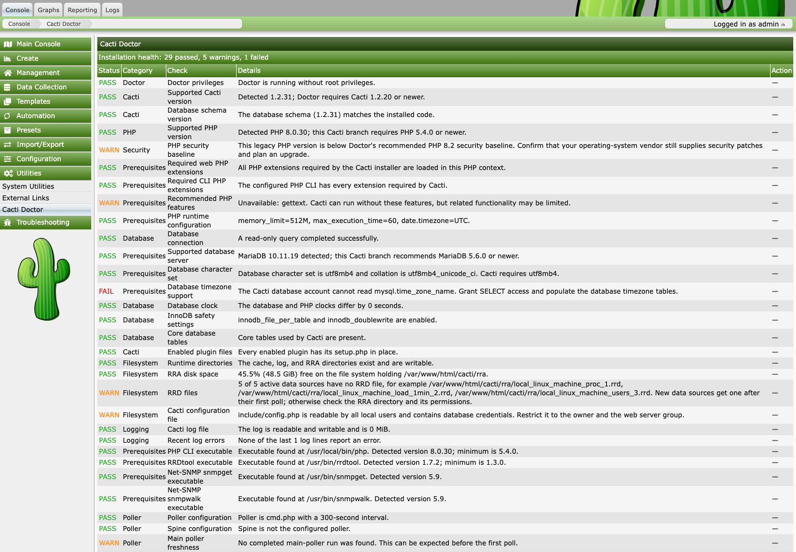
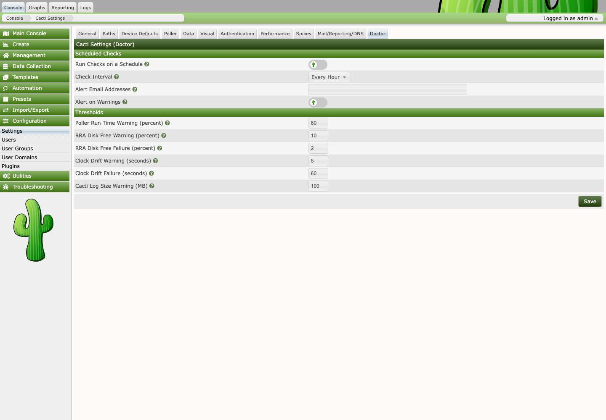

<h1 align="center">
	<picture>
		<source media="(prefers-color-scheme: dark)" srcset="images/doctor_logo_dark.png">
		
	</picture>
</h1>

<p align="center">
	<a href="https://github.com/somethingwithproof/plugin_doctor/actions/workflows/ci.yml"></a>
	<a href="https://sonarcloud.io/summary/new_code?id=somethingwithproof_plugin_doctor"></a>
	<a href="https://scorecard.dev/viewer/?uri=github.com/somethingwithproof/plugin_doctor"></a>
	<a href="LICENSE"></a>
	
	
</p>

Cacti Doctor is a Cacti plugin that diagnoses an installation in one pass and applies small repairs only when an administrator asks for them.

## Screenshots

Diagnostics and scheduling settings in an isolated Cacti 1.2.31 demonstration
installation running PHP 8.3.36, including the Cacti PHP compatibility, upstream
security-support, and database-health checks. Warnings and failures shown here
describe that demo environment.





Cacti problems usually surface as symptoms: empty graphs, a poller that stopped, a plugin that will not install. The cause is often a prerequisite that drifted, such as a missing PHP extension in the CLI build, a log directory the poller cannot write, an RRDtool path that points at the wrong binary, or a database without timezone tables. Doctor checks those prerequisites directly and reports each one as pass, warn, or fail with a sentence explaining what it found. The same report is available on a web page, on the command line, and as JSON for monitoring.

## What it checks

| Area | Checks |
|---|---|
| Doctor | Whether Doctor itself runs as root, which would make permission checks describe the wrong account |
| Cacti and PHP | Cacti version, an upgrade the installer never finished, enabled plugins whose files are missing, PHP compatibility with the installed Cacti package, PHP upstream security-support status |
| PHP extensions | Required extensions in the web PHP and in the CLI PHP the poller uses, plus recommended features |
| PHP configuration | `memory_limit`, `max_execution_time`, and `date.timezone`, using Cacti's own recommendations |
| Database | Connectivity, server version against Cacti's recommendation, UTF-8 character set, timezone tables, core tables, clock drift from the PHP host, and the InnoDB settings Cacti flags as errors |
| Database health | Connection capacity, buffer-pool reads, disk temporary tables, connection thread creation, slow statements, and InnoDB log-buffer waits, with workload-dependent tuning suggestions |
| Filesystem | Writable cache, log, and RRA directories; free space for RRD files; active data sources with no RRD file; `include/config.php` not world-readable; Cacti log writable and not oversized |
| Binaries | PHP CLI, RRDtool, `snmpget`, `snmpwalk`, and Spine when it is the configured poller, including versions where Cacti states one |
| Log | Errors among the most recent Cacti log lines, with the most frequent message |
| Devices | Enabled devices that are down or recovering, the three down longest with their last error, and a failure when most devices are down at once |
| Poller | Poller type and interval, time since the main poller last completed, run time against the interval, poller output that never reached an RRD file, remote pollers that stopped reporting, a stalled Boost, and a Spine configuration that points at a different database |

Every check has a stable ID, such as `database.timezone` or `binary.rrdtool`, so scripts can key on individual results.

## Database health advice

Doctor's native PHP analyzer reads a fixed set of global MySQL or MariaDB counters through Cacti's existing database connection. It makes two read-only queries per report, requires no extra credentials or executable, and never changes database configuration. These checks appear in the web report, CLI, JSON, monitoring output, support bundle, and scheduled status tracking.

| Check ID | Investigation trigger |
|---|---|
| `database.health_sample` | Less than 24 hours since startup or `FLUSH STATUS`, or unavailable/inconsistent uptime |
| `database.connection_capacity` | Current or recorded peak connections at least 80% of the current `max_connections` |
| `database.buffer_pool_reads` | `Innodb_buffer_pool_reads / Innodb_buffer_pool_read_requests` at least 1%, with at least 10,000 read requests |
| `database.temporary_tables` | `Created_tmp_disk_tables / Created_tmp_tables` at least 25%, with at least 1,000 temporary tables |
| `database.thread_cache` | `Threads_created / Connections` at least 5%, with at least 1,000 connection attempts and `thread_handling=one-thread-per-connection` |
| `database.slow_queries` | `Slow_queries / Queries` at least 1%, with at least 1,000 statements |
| `database.redo_log_waits` | Nonzero `Innodb_log_waits` |

These are Doctor's investigation thresholds, not vendor configuration targets. Except for connection capacity, cumulative advice requires the observation window above. Missing, malformed, duplicate, or oversized counters, insufficient activity, and unsupported thread modes produce warnings instead of a healthy verdict or a tuning recommendation. Warnings can affect Nagios status and scheduled alerts when **Alert on Warnings** is enabled.

Read the measured counters and suggestion together. Cumulative values do not establish current load; counters can have different reset histories and are not an atomic snapshot. Peak connections may reflect an older limit. Slow-query counts depend on `long_query_time`, and MySQL's disk temporary-table counter can omit memory-mapped files. A low ratio does not prove the absence of a bottleneck. Confirm trends under a representative workload, review query plans and connection reuse, and measure memory on the **database host** before changing buffers or connection limits.

If metrics are unavailable, check server support and the Cacti account's access to `SHOW GLOBAL STATUS` and `SHOW GLOBAL VARIABLES`; Doctor does not request elevated credentials. Counter definitions come from the [MySQL status-variable reference](https://dev.mysql.com/doc/refman/8.0/en/server-status-variables.html) and [MariaDB status-variable reference](https://mariadb.com/docs/server/server-management/variables-and-modes/server-status-variables). No MySQLTuner script or code is used.

No schema or configuration migration is needed. Deploy the plugin files normally; reverting those files removes the added diagnostics. Existing scheduled state is refreshed on the next run.

## How it stays safe

A diagnostic tool runs with the poller's or web server's privileges and reads paths from the settings table, so it has to be careful about what it executes and modifies.

- Diagnostics are read-only. They never change files, settings, or data.
- Doctor runs a configured binary only when its file name matches the expected program (`php`, `rrdtool`, `snmpget`, or `snmpwalk`). Anyone who can write the settings table could otherwise choose what Doctor runs. Any other name is reported as a warning and is not executed.
- Doctor never runs configured binaries as root, and it reports when it is running as root.
- Repairs come from a fixed allow-list. Each one needs an authenticated administrator action in the web UI or `--yes` on the CLI, and each one is written to the Cacti log.

## Releases

Versions follow SemVer and match the plugin's `INFO` file. See the
[release process](docs/releasing.md) for version selection, CI gates, package
contents, checksums, and rollback instructions.

## Installation

Download `doctor-VERSION.tar.gz` or `doctor-VERSION.zip` and `SHA256SUMS` from
[GitHub Releases](https://github.com/somethingwithproof/plugin_doctor/releases).
Verify the archive's SHA-256 checksum, then extract its `doctor/` directory into
Cacti's `plugins/` directory. These are the installable packages; GitHub's
automatic source archives have a different directory name.

For source checkouts:

Clone or unpack the repository as `plugins/doctor` inside a Cacti installation. The directory must be named `doctor`, not `plugin_doctor`.

```console
cd /path/to/cacti/plugins
git clone https://github.com/somethingwithproof/plugin_doctor.git doctor
```

Install and enable **Cacti Doctor** from **Configuration > Plugin Management**, then grant the **Cacti Doctor** realm to administrators who should have access. The report appears under **Utilities > Cacti Doctor**.

## Languages

Doctor ships translations into Spanish (Spain, `es-ES`), French (`fr-FR`), German (`de-DE`), Simplified Chinese (`zh-CN`), and Japanese (`ja-JP`). Cacti shows them once language support is on (**Configuration > Settings > General > Language Support**) and a user picks the language. The web page, the settings, and the messages and report text the command line prints follow Cacti's language; the command-line report itself uses the Cacti default language, which stays English unless you change it.

Machine-readable output is never translated: check IDs, JSON keys and status values, the `--format=nagios` and `--format=prometheus` output, log lines, and the support-bundle section headings stay in English so scripts and monitoring keep working in every language. The `summary` and `detail` text of each check is the one translated part of the JSON report.

A Latin American Spanish catalog (`es-419`) ships as well, but neither Cacti 1.2 nor Cacti 1.3 has a Latin American Spanish locale to select, so it takes effect only when Cacti adds one. Until then, choose Spanish (`es-ES`).

Cacti loads a plugin's catalog from `plugins/doctor/locales/LC_MESSAGES/<locale>.mo` with `doctor` as the text domain, on 1.2.x and 1.3 alike (1.3 resolves the plugin directory through its configurable plugins path).

## Command line

Run these from the Cacti root as the Cacti poller user, not root:

```console
php plugins/doctor/cli/doctor.php
php plugins/doctor/cli/doctor.php --json
php plugins/doctor/cli/doctor.php --repair=runtime_directories --yes
```

Text output prints one line per check with its status, category, summary, and detail. `--json` prints a `summary` object with status counts and a `checks` array whose entries carry `id`, `category`, `status`, `summary`, `detail`, and `repair`/`repairable` when an allow-listed repair applies.

| Exit status | Meaning |
|---|---|
| `0` | No check failed, or the requested repair succeeded. Warnings do not change the exit status. |
| `1` | At least one check failed, or a requested repair did not succeed. |
| `2` | A repair was requested without `--yes`. |

Cacti raises `memory_limit` for every CLI script, so the PHP runtime configuration check is only meaningful on the web page.

## Scheduled checks and alerts

Under **Configuration > Settings > Doctor**, turn on **Run Checks on a Schedule** and pick an interval from 15 minutes to a day. After each poller cycle that falls due, Doctor runs every check in a background process, so the poller's own run time is unaffected.

Each run records every check's status. When a check starts or stops failing, Doctor writes the change to the Cacti log and, if **Alert Email Addresses** is set, emails those addresses through Cacti's mail settings. **Alert on Warnings** adds changes into and out of warnings. The first run only records a baseline.

Scheduled reports run on the primary poller under a database advisory lock and have a two-minute worker limit. Doctor reports the last start and successful completion so missing or stale results are visible. Failed alert delivery is retained for up to three retries with increasing delays; after that, correct Cacti's mail settings and run `php plugins/doctor/cli/doctor.php --scheduled --retry-alerts` as the poller user. Mail-server acceptance does not confirm inbox delivery.

The same tab sets the thresholds for poller run time (80% of the interval), RRA free disk space (warn below 10%, fail below 2%), database clock drift (warn over 5 seconds, fail over 60), and Cacti log size (100 MB). Empty or invalid values fall back to these defaults.

## Monitoring integration

```console
php plugins/doctor/cli/doctor.php --format=nagios
php plugins/doctor/cli/doctor.php --format=prometheus > /var/lib/node_exporter/textfile/cacti_doctor.prom
```

`--format=nagios` prints one status line with performance data and exits `0` (OK), `1` (WARNING), or `2` (CRITICAL), so Nagios, Icinga, or any compatible system can run it directly. `--format=prometheus` writes the Prometheus text format for node_exporter's textfile collector: `cacti_doctor_check_status` per check (0 pass, 1 warn, 2 fail), `cacti_doctor_checks` per status, and `cacti_doctor_last_run_timestamp_seconds`. JSON check rows include an `assessment` field; `not_assessed` means the check could not reach a conclusion from the available data.

## Support bundle

```console
php plugins/doctor/cli/doctor.php --bundle=/tmp/cacti-doctor.txt
```

The bundle is a single text file with the Doctor, Cacti, PHP, OS, and database versions, poller and Boost statistics, the full report, and the last 200 lines of the Cacti log. Values that follow password, secret, token, community, and key names are masked. Doctor creates the file readable only by its owner and refuses to overwrite an existing file. Review it before posting it anywhere.

## Repair policy

Doctor includes one repair, `runtime_directories`. It creates missing Cacti runtime directories and adds owner read, write, and execute bits without removing existing permissions.

It targets `$cache_path`, `$log_path`, and `$rra_path` on Cacti 1.3, or the installation's `cache`, `log`, and `rra` directories otherwise. It skips directories that are already writable, refuses directories outside the Cacti installation (such as a log directory under `/var/log`), refuses symbolic links, and refuses to run as root. It never follows `path_cactilog`, so a log file configured inside a code directory cannot redirect the repair there. The diagnostic still checks the configured log file's directory on every release.

It does not change ownership, run shell commands, rewrite configuration, or modify Cacti application data. New repairs must each include a diagnostic, an allow-listed handler, confirmation, audit logging, and tests.

## Requirements

| Cacti | PHP | Notes |
|---|---|---|
| 1.2.20 | 5.4 or newer | Doctor's own code is PHP 5.4 compatible so it can diagnose legacy systems before an upgrade |
| 1.2.31 | 8.0 or newer | Cacti's `composer.json` requires `>=8.0` |
| Current 1.2.x | 8.2 or newer | Cacti's `composer.json` requires `>=8.2` |
| `develop` (1.3) | 8.3 or newer | Cacti's `composer.json` requires `^8.3` |

The **PHP compatibility with installed Cacti** row compares the running PHP version with the PHP requirement in Cacti's own root `composer.json`, including the upper bound of a caret constraint such as `^8.3`. The configured PHP CLI executable is checked against the same requirement. Doctor recognizes the `>=` and `^` constraint forms used by these Cacti packages. An unreadable, malformed, missing, or unrecognized requirement produces a warning; Cacti 1.2.20–1.2.30 installations without a manifest retain their documented PHP 5.4 installer floor. Doctor's own PHP 5.4 compatibility does not establish compatibility with a newer Cacti installation.

The **PHP upstream security support** row answers a separate question: does that PHP release branch still receive security fixes from the PHP project? It reports the branch's published security-support end date and warns after that date. For example, PHP 8.1 can meet an older Cacti installation's runtime requirement while no longer receiving upstream security fixes. A passing result does not mean the installed patch release is current, and Doctor cannot determine whether an OS vendor supplies backported fixes.

Support dates are bundled with Doctor from the [PHP support schedule](https://www.php.net/supported-versions.php) and [end-of-life list](https://www.php.net/eol.php), last checked on 2026-11-08. Unknown branches and prereleases produce a warning rather than an assumed pass. No network request is made during diagnostics. Update Doctor's support data when PHP publishes a new schedule. Existing JSON/monitoring IDs `php.version` and `php.security_baseline` are unchanged.

## Development

The unit suite uses Pest and runs on PHP 8.2 or newer:

```console
composer install
composer test
```

The tests replace the Cacti functions Doctor calls with small stand-ins in `tests/CactiStubs.php`, so they run without a Cacti installation.

GitHub Actions runs three layers of checks on every push and pull request:

- `php -l` on every PHP file under PHP 5.4, 5.6, 7.0, 7.1, 7.4, and 8.0 through 8.4.
- The unit suite on PHP 8.2, 8.3, and 8.4.
- `locales/build_gettext.sh --check`, which fails on a stale translation template, an incomplete or fuzzy catalog, or a compiled catalog that differs from its source.
- Seven integration jobs that install Cacti 1.2.20, the current 1.2.x branch, and `develop` against MySQL and MariaDB, with both cmd.php and Spine. Each job installs and enables the plugin, runs the full CLI report, and checks the report schema, summary totals, expected statuses, and the exact set of failures. It then breaks a binary path and the poller timestamp, confirms both are reported, restores them, exercises the repair and its confirmation, and runs disable, enable, uninstall, and reinstall. The JSON report is kept as an artifact when a job fails.

## Contributing

Pull requests go to `develop`. Keep production files PHP 5.4 compatible and use Cacti's style: tabs, single-quoted strings, and Cacti helpers such as `read_config_option()` and `db_fetch_cell()`. Add a unit test for each behavior change, sign off your commits (`git commit -s`), and add a line to `CHANGELOG.md`.

### Translations

Wrap every user-visible message in `__('...', 'doctor')` (or `__n()`, `__x()`, `__esc()`), and give a sentence that contains a value a single format string with sequential `%s`/`%d` placeholders rather than concatenating pieces. Cacti's `__()` formats a message only when it contains a format specifier, does not support positional `%1$s` forms, and reads the `%%` escape for a literal percent sign. Keep check IDs, JSON keys, status keywords, monitoring output, and log lines untranslated.

`locales/build_gettext.sh` regenerates the template `locales/po/cacti.pot`, merges it into each catalog `locales/po/<locale>.po`, and compiles `locales/LC_MESSAGES/<locale>.mo`; commit all three. CI runs `sh locales/build_gettext.sh --check`, which fails when the template is stale or a catalog misses or has a fuzzy entry, a placeholder differs, or a compiled file is out of date. A changed message therefore needs its translations updated in the same pull request. It needs GNU gettext (`xgettext`, `msgmerge`, `msgfmt`, `msgunfmt`). A new language is a new `<locale>.po` named as Cacti names its locales (for example `pt-BR`).

## Security

Report vulnerabilities privately as described in [SECURITY.md](SECURITY.md), not in public issues.

## License

Copyright (C) 2026 Thomas Vincent. Released under the GNU General Public License, version 2 or later. See [LICENSE](LICENSE).
