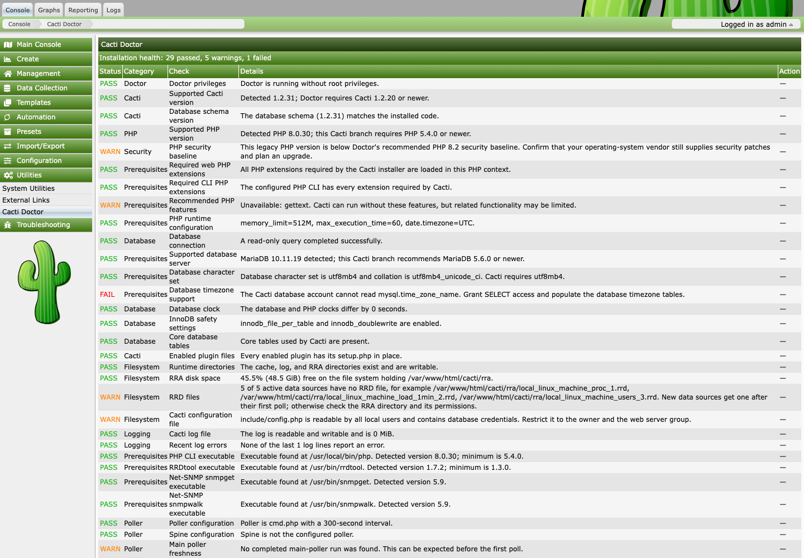

<!-- Source: README.md; SHA256: 490628bb7f70f4cf1a8c43b302246fd2e870725a6649c628762608b4a76db65b -->

<!-- translations:start -->
[English](../../../README.md) | [简体中文](../zh-CN/README.md) | [हिन्दी](../hi-IN/README.md) | [Español (España)](../es-ES/README.md) | [Español (Latinoamérica)](../es-419/README.md) | [العربية (السعودية)](../ar-SA/README.md) | [Afrikaans](../af-ZA/README.md) | [አማርኛ](../am-ET/README.md) | [العربية (مصر)](../ar-EG/README.md) | [العربية (المغرب)](../ar-MA/README.md) | [Български](../bg-BG/README.md) | [বাংলা](../bn-BD/README.md) | [Bosanski](../bs-BA/README.md) | [Deutsch](../de-DE/README.md) | [Ελληνικά](README.md) | [فارسی](../fa-IR/README.md) | [Filipino](../fil-PH/README.md) | [Français](../fr-FR/README.md) | [Français (Maroc)](../fr-MA/README.md) | [Français (Sénégal)](../fr-SN/README.md) | [Hausa](../ha-NG/README.md) | [עברית](../he-IL/README.md) | [Hrvatski](../hr-HR/README.md) | [Bahasa Indonesia](../id-ID/README.md) | [Igbo](../ig-NG/README.md) | [Italiano](../it-IT/README.md) | [日本語](../ja-JP/README.md) | [한국어](../ko-KR/README.md) | [Malagasy](../mg-MG/README.md) | [मराठी](../mr-IN/README.md) | [Bahasa Melayu](../ms-MY/README.md) | [Nederlands](../nl-NL/README.md) | [Polski](../pl-PL/README.md) | [Português (Brasil)](../pt-BR/README.md) | [Русский](../ru-RU/README.md) | [Kinyarwanda](../rw-RW/README.md) | [Soomaali](../so-SO/README.md) | [Српски](../sr-RS/README.md) | [Svenska](../sv-SE/README.md) | [Kiswahili](../sw-KE/README.md) | [தமிழ்](../ta-IN/README.md) | [తెలుగు](../te-IN/README.md) | [ไทย](../th-TH/README.md) | [Türkçe](../tr-TR/README.md) | [Українська](../uk-UA/README.md) | [اردو](../ur-PK/README.md) | [Tiếng Việt](../vi-VN/README.md) | [isiXhosa](../xh-ZA/README.md) | [Yorùbá](../yo-NG/README.md) | [繁體中文](../zh-TW/README.md) | [isiZulu](../zu-ZA/README.md)
<!-- translations:end -->

<h1 align="center">
	<picture>
		<source media="(prefers-color-scheme: dark)" srcset="../../../images/doctor_logo_dark.png">
		
	</picture>
</h1>

<p align="center">
	<a href="https://github.com/somethingwithproof/plugin_doctor/actions/workflows/ci.yml"></a>
	<a href="https://sonarcloud.io/summary/new_code?id=somethingwithproof_plugin_doctor"></a>
	<a href="https://scorecard.dev/viewer/?uri=github.com/somethingwithproof/plugin_doctor"></a>
	<a href="../../../LICENSE"></a>
	
	
</p>

Το Cacti Doctor είναι ένα πρόσθετο του Cacti που διαγιγνώσκει μια εγκατάσταση με ένα πέρασμα και εφαρμόζει μικρές επιδιορθώσεις μόνο όταν το ζητήσει ένας διαχειριστής.

**Κατάσταση: υπό ανάπτυξη, πριν από την 1.0.** Η πιο πρόσφατη έκδοση είναι η [0.6.1](https://github.com/somethingwithproof/plugin_doctor/releases/tag/v0.6.1). Αυτή η διορθωτική έκδοση προσθέτει καταλόγους Χίντι και Αραβικών καθώς και μεταφρασμένους οδηγούς χρήσης στην πρόσβαση βάσει ρόλων, την καθοδηγούμενη διάγνωση, τους ελέγχους επικαιρότητας RRD με περιορισμό εύρους, τις προεπισκοπήσεις επιδιορθώσεων και το ιστορικό ελέγχου (audit), τις αποδεκτές εξαιρέσεις προειδοποιήσεων και τις μεταφράσεις της έκδοσης 0.6.0. Δείτε το [CHANGELOG.md](../../../CHANGELOG.md) για λεπτομέρειες.

## Στιγμιότυπα οθόνης

Διαγνωστικά και ρυθμίσεις χρονοπρογραμματισμού σε μια απομονωμένη δοκιμαστική εγκατάσταση Cacti 1.2.31 με PHP 8.3.36, συμπεριλαμβανομένων των ελέγχων συμβατότητας PHP με το Cacti, επίσημης υποστήριξης ασφαλείας και υγείας βάσης δεδομένων. Οι προειδοποιήσεις και οι αποτυχίες που εμφανίζονται εδώ περιγράφουν αυτό το περιβάλλον επίδειξης.




Τα προβλήματα του Cacti εμφανίζονται συνήθως ως συμπτώματα: κενά γραφήματα, ένας poller που σταμάτησε, ένα πρόσθετο που δεν εγκαθίσταται. Η αιτία είναι συχνά μια προϋπόθεση που άλλαξε, όπως μια επέκταση PHP που λείπει από την έκδοση CLI, ένας κατάλογος καταγραφής στον οποίο δεν μπορεί να γράψει ο poller, μια διαδρομή RRDtool που δείχνει σε λάθος εκτελέσιμο ή μια βάση δεδομένων χωρίς πίνακες ζώνης ώρας. Το Doctor ελέγχει αυτές τις προϋποθέσεις απευθείας και αναφέρει καθεμία ως επιτυχία, προειδοποίηση ή αποτυχία με μια πρόταση που εξηγεί τι βρέθηκε. Η ίδια αναφορά είναι διαθέσιμη σε ιστοσελίδα, στη γραμμή εντολών και ως JSON για παρακολούθηση.

## Τι ελέγχει

| Τομέας | Έλεγχοι |
|---|---|
| Doctor | Εάν το ίδιο το Doctor εκτελείται ως root, κάτι που θα έκανε τους ελέγχους δικαιωμάτων να περιγράφουν λάθος λογαριασμό |
| Cacti και PHP | Έκδοση Cacti, μια αναβάθμιση που δεν ολοκλήρωσε ποτέ το πρόγραμμα εγκατάστασης, ενεργοποιημένα πρόσθετα των οποίων λείπουν αρχεία, συμβατότητα PHP με το εγκατεστημένο πακέτο Cacti, κατάσταση επίσημης υποστήριξης ασφαλείας της PHP |
| Επεκτάσεις PHP | Απαιτούμενες επεκτάσεις στην web PHP και στην CLI PHP που χρησιμοποιεί ο poller, καθώς και προτεινόμενες δυνατότητες |
| Ρύθμιση PHP | `memory_limit`, `max_execution_time` και `date.timezone`, με βάση τις συστάσεις του ίδιου του Cacti |
| Βάση δεδομένων | Συνδεσιμότητα, έκδοση διακομιστή σε σχέση με τη σύσταση του Cacti, σύνολο χαρακτήρων UTF-8, πίνακες ζώνης ώρας, βασικοί πίνακες, απόκλιση ρολογιού από τον κόμβο PHP και οι ρυθμίσεις InnoDB που το Cacti επισημαίνει ως σφάλματα |
| Υγεία βάσης δεδομένων | Χωρητικότητα συνδέσεων, αναγνώσεις buffer pool, προσωρινοί πίνακες στον δίσκο, δημιουργία νημάτων σύνδεσης, αργές εντολές και αναμονές log-buffer του InnoDB, με προτάσεις βελτιστοποίησης ανάλογα με τον φόρτο |
| Σύστημα αρχείων | Εγγράψιμοι κατάλογοι cache, log και RRA· ελεύθερος χώρος για αρχεία RRD· ενεργές πηγές δεδομένων χωρίς αρχείο RRD ή με καθυστερημένες ενημερώσεις αρχείων· το `include/config.php` να μην είναι καθολικά αναγνώσιμο· το αρχείο καταγραφής Cacti να είναι εγγράψιμο και όχι υπερμεγέθες |
| Εκτελέσιμα | PHP CLI, RRDtool, `snmpget`, `snmpwalk` και Spine όταν είναι ο ρυθμισμένος poller, συμπεριλαμβανομένων των εκδόσεων όπου το Cacti ορίζει κάποια |
| Καταγραφή | Σφάλματα στις πιο πρόσφατες γραμμές του αρχείου καταγραφής του Cacti, μαζί με το πιο συχνό μήνυμα |
| Συσκευές | Ενεργοποιημένες συσκευές που είναι εκτός λειτουργίας ή σε ανάκαμψη, οι τρεις που βρίσκονται περισσότερο χρόνο εκτός λειτουργίας με το τελευταίο σφάλμα τους και αποτυχία όταν οι περισσότερες συσκευές είναι ταυτόχρονα εκτός λειτουργίας |
| Poller | Τύπος και διάστημα του poller, χρόνος από την τελευταία ολοκλήρωση του κύριου poller, χρόνος εκτέλεσης σε σχέση με το διάστημα, αποτελέσματα poller που δεν έφτασαν ποτέ σε αρχείο RRD, απομακρυσμένοι pollers που σταμάτησαν να αναφέρουν, ένα κολλημένο Boost και ρύθμιση Spine που δείχνει σε διαφορετική βάση δεδομένων |

Κάθε έλεγχος διαθέτει σταθερό αναγνωριστικό, όπως `database.timezone` ή `binary.rrdtool`, ώστε τα σενάρια (scripts) να μπορούν να βασίζονται σε μεμονωμένα αποτελέσματα. Τα ενεργοποιημένα πρόσθετα μπορούν να συνεισφέρουν πρόσθετους ελέγχους και συνημμένα πακέτου υποστήριξης μέσω του hook `doctor_register_checks`, ενώ το Doctor εκθέτει διαγνωστικές δυνατότητες μόνο για ανάγνωση στο `plugin_mcp` μέσω του `abilities_register`.

## Χάρτης κώδικα και δοκιμών

| Συμπεριφορά | Υλοποίηση | Τεκμηρίωση δοκιμών σε αυτό το αποθετήριο |
|---|---|---|
| Διαγνωστικοί έλεγχοι και σταθερά αναγνωριστικά αναφοράς | [doctor_functions.php](../../../doctor_functions.php) | [DoctorFunctionsTest.php](../../../tests/DoctorFunctionsTest.php), [DatabaseHealthTest.php](../../../tests/DatabaseHealthTest.php), [AssertDoctorReport.php](../../../tests/ci/AssertDoctorReport.php) |
| Hook ελέγχων προσθέτων (`doctor_register_checks`) | [doctor_plugins.php](../../../doctor_plugins.php) | [PluginHooksTest.php](../../../tests/PluginHooksTest.php) |
| Διαγνωστικές δυνατότητες MCP (`abilities_register`) | [doctor_abilities.php](../../../doctor_abilities.php) | [AbilitiesTest.php](../../../tests/AbilitiesTest.php) |
| Πρόσβαση βάσει ρόλων και αναφορές ιστού με απόκρυψη δεδομένων | [doctor_access.php](../../../doctor_access.php), [doctor_web.php](../../../doctor_web.php) | [AccessTest.php](../../../tests/AccessTest.php), [WebAccessTest.php](../../../tests/WebAccessTest.php) |
| Καθοδηγούμενες διερευνήσεις συμπτωμάτων | [doctor_diagnosis.php](../../../doctor_diagnosis.php) | [DiagnosisTest.php](../../../tests/DiagnosisTest.php) |
| Επικαιρότητα RRD και διαχείριση αναβαλλόμενων εγγραφών | [doctor_rrd.php](../../../doctor_rrd.php) | [RrdFreshnessTest.php](../../../tests/RrdFreshnessTest.php) |
| Προεπισκοπήσεις επιδιορθώσεων, ιστορικό ελέγχου και αποδεκτές προειδοποιήσεις | [doctor_workflows.php](../../../doctor_workflows.php), [doctor_web.php](../../../doctor_web.php) | [WorkflowTest.php](../../../tests/WorkflowTest.php) |
| Προγραμματισμένοι έλεγχοι και μεταβάσεις ειδοποιήσεων | [doctor_scheduling.php](../../../doctor_scheduling.php) | [DoctorFunctionsTest.php](../../../tests/DoctorFunctionsTest.php), [WorkflowTest.php](../../../tests/WorkflowTest.php) |

Αυτές οι αναφορές προσδιορίζουν την υλοποίηση και την κάλυψη δοκιμών· δεν δηλώνουν ότι κάθε εργασία CI πέτυχε για την τρέχουσα αναθεώρηση. Ελέγξτε την εκτέλεση της ροής εργασίας για την αναθεώρηση που σκοπεύετε να αναπτύξετε.

## Συμβουλές υγείας βάσης δεδομένων

Ο εγγενής αναλυτής PHP του Doctor διαβάζει ένα σταθερό σύνολο καθολικών μετρητών MySQL ή MariaDB μέσω της υπάρχουσας σύνδεσης βάσης δεδομένων του Cacti. Εκτελεί δύο ερωτήματα μόνο για ανάγνωση ανά αναφορά, δεν απαιτεί επιπλέον διαπιστευτήρια ή εκτελέσιμο αρχείο και δεν αλλάζει ποτέ τη ρύθμιση της βάσης δεδομένων. Αυτοί οι έλεγχοι εμφανίζονται στην αναφορά ιστού, στη CLI, στο JSON, στην έξοδο παρακολούθησης, στο πακέτο υποστήριξης και στην προγραμματισμένη παρακολούθηση κατάστασης.

| Αναγνωριστικό ελέγχου | Κριτήριο διερεύνησης |
|---|---|
| `database.health_sample` | Λιγότερο από 24 ώρες από την εκκίνηση ή το `FLUSH STATUS`, ή μη διαθέσιμος/ασυνεπής χρόνος λειτουργίας |
| `database.connection_capacity` | Τρέχουσες ή καταγεγραμμένες συνδέσεις αιχμής τουλάχιστον 80% του τρέχοντος `max_connections` |
| `database.buffer_pool_reads` | `Innodb_buffer_pool_reads / Innodb_buffer_pool_read_requests` τουλάχιστον 1%, με τουλάχιστον 10.000 αιτήματα ανάγνωσης |
| `database.temporary_tables` | `Created_tmp_disk_tables / Created_tmp_tables` τουλάχιστον 25%, με τουλάχιστον 1.000 προσωρινούς πίνακες |
| `database.thread_cache` | `Threads_created / Connections` τουλάχιστον 5%, με τουλάχιστον 1.000 προσπάθειες σύνδεσης και `thread_handling=one-thread-per-connection` |
| `database.slow_queries` | `Slow_queries / Queries` τουλάχιστον 1%, με τουλάχιστον 1.000 εντολές |
| `database.redo_log_waits` | Μη μηδενικό `Innodb_log_waits` |

Αυτά είναι όρια διερεύνησης του Doctor και όχι στόχοι ρύθμισης των κατασκευαστών. Εκτός από τη χωρητικότητα συνδέσεων, οι αθροιστικές συμβουλές απαιτούν το παραπάνω παράθυρο παρατήρησης. Ελλιπείς, κακοσχηματισμένοι, διπλότυποι ή υπερβολικά μεγάλοι μετρητές, ανεπαρκής δραστηριότητα και μη υποστηριζόμενες λειτουργίες νημάτων παράγουν προειδοποιήσεις αντί για θετική αξιολόγηση ή σύσταση βελτιστοποίησης. Οι προειδοποιήσεις μπορούν να επηρεάσουν την κατάσταση Nagios και τις προγραμματισμένες ειδοποιήσεις όταν είναι ενεργοποιημένη η επιλογή **Ειδοποίηση για προειδοποιήσεις**.

Διαβάστε τους μετρημένους μετρητές και τη σύσταση μαζί. Οι αθροιστικές τιμές δεν αποδεικνύουν τον τρέχοντα φόρτο· οι μετρητές ενδέχεται να έχουν διαφορετικό ιστορικό επαναφοράς και δεν αποτελούν ατομικό στιγμιότυπο. Οι συνδέσεις αιχμής μπορεί να αντικατοπτρίζουν παλαιότερο όριο. Ο αριθμός αργών ερωτημάτων εξαρτάται από το `long_query_time`, ενώ ο μετρητής προσωρινών πινάκων δίσκου της MySQL μπορεί να παραλείπει αρχεία με αντιστοίχιση μνήμης. Ένα χαμηλό ποσοστό δεν αποδεικνύει την απουσία σημείου συμφόρησης. Επιβεβαιώστε τις τάσεις υπό αντιπροσωπευτικό φόρτο εργασίας, ελέγξτε τα πλάνα εκτέλεσης ερωτημάτων και την επαναχρησιμοποίηση συνδέσεων και μετρήστε τη μνήμη στον **διακομιστή βάσης δεδομένων** πριν αλλάξετε buffers ή όρια συνδέσεων.

Εάν οι μετρήσεις δεν είναι διαθέσιμες, ελέγξτε την υποστήριξη διακομιστή και την πρόσβαση του λογαριασμού Cacti στα `SHOW GLOBAL STATUS` και `SHOW GLOBAL VARIABLES`· το Doctor δεν ζητά αυξημένα διαπιστευτήρια. Οι ορισμοί των μετρητών προέρχονται από την [τεκμηρίωση μεταβλητών κατάστασης MySQL](https://dev.mysql.com/doc/refman/8.0/en/server-status-variables.html) και την [τεκμηρίωση μεταβλητών κατάστασης MariaDB](https://mariadb.com/docs/server/server-management/variables-and-modes/server-status-variables). Δεν χρησιμοποιείται κανένα σενάριο ή κώδικας του MySQLTuner.

Δεν απαιτείται μετεγκατάσταση σχήματος ή ρυθμίσεων. Αναπτύξτε τα αρχεία του πρόσθετου κανονικά· η επαναφορά αυτών των αρχείων αφαιρεί τα πρόσθετα διαγνωστικά. Η υπάρχουσα προγραμματισμένη κατάσταση ανανεώνεται στην επόμενη εκτέλεση.

## Πώς παραμένει ασφαλές

Ένα διαγνωστικό εργαλείο εκτελείται με τα δικαιώματα του poller ή του διακομιστή ιστού και διαβάζει διαδρομές από τον πίνακα ρυθμίσεων, επομένως πρέπει να είναι προσεκτικό σχετικά με το τι εκτελεί και τροποποιεί.

- Τα διαγνωστικά είναι μόνο για ανάγνωση. Δεν αλλάζουν ποτέ αρχεία, ρυθμίσεις ή δεδομένα.
- Το Doctor εκτελεί ένα ρυθμισμένο εκτελέσιμο μόνο όταν το όνομα αρχείου του αντιστοιχεί στο αναμενόμενο πρόγραμμα (`php`, `rrdtool`, `snmpget` ή `snmpwalk`). Διαφορετικά, οποιοσδήποτε μπορεί να γράψει στον πίνακα ρυθμίσεων θα μπορούσε να επιλέξει τι εκτελεί το Doctor. Οποιοδήποτε άλλο όνομα αναφέρεται ως προειδοποίηση και δεν εκτελείται.
- Το Doctor δεν εκτελεί ποτέ ρυθμισμένα εκτελέσιμα ως root και αναφέρει πότε εκτελείται ως root.
- Οι επιδιορθώσεις προέρχονται από μια σταθερή λίστα επιτρεπόμενων. Κάθε μία απαιτεί πιστοποιημένη ενέργεια διαχειριστή στη διεπαφή ιστού ή `--yes` στη CLI και καταγράφεται στο αρχείο καταγραφής του Cacti.

## Εκδόσεις

Οι εκδόσεις ακολουθούν το SemVer και αντιστοιχούν στο αρχείο `INFO` του πρόσθετου. Δείτε τη [διαδικασία κυκλοφορίας](../../releasing.md) για επιλογή έκδοσης, πύλες CI, περιεχόμενα πακέτου, αθροίσματα ελέγχου και οδηγίες επαναφοράς.

## Εγκατάσταση

Κατεβάστε το `doctor-VERSION.tar.gz` ή `doctor-VERSION.zip` και το `SHA256SUMS` από τις [Εκδόσεις GitHub](https://github.com/somethingwithproof/plugin_doctor/releases). Επαληθεύστε το άθροισμα ελέγχου SHA-256 του αρχείου και στη συνέχεια αποσυμπιέστε τον κατάλογο `doctor/` στον κατάλογο `plugins/` του Cacti. Αυτά είναι τα εγκαταστάσιμα πακέτα· τα αυτόματα αρχεία πηγαίου κώδικα του GitHub έχουν διαφορετικό όνομα καταλόγου. Για να εκτελέσετε μη κυκλοφορημένο κώδικα από το `develop`, εγκαταστήστε από αντίγραφο πηγαίου κώδικα.

Για αντίγραφα πηγαίου κώδικα:

Κλωνοποιήστε ή αποσυμπιέστε το αποθετήριο ως `plugins/doctor` μέσα σε μια εγκατάσταση Cacti. Ο κατάλογος πρέπει να ονομάζεται `doctor` και όχι `plugin_doctor`.

```console
cd /path/to/cacti/plugins
git clone https://github.com/somethingwithproof/plugin_doctor.git doctor
```

Εγκαταστήστε και ενεργοποιήστε το **Cacti Doctor** από **Ρυθμίσεις > Διαχείριση πρόσθετων** και στη συνέχεια παραχωρήστε ένα δικαίωμα (realm) **Θεατής Doctor**, **Χειριστής Doctor** ή **Διαχειριστής Doctor** μέσω των δικαιωμάτων χρηστών ή ομάδων του Cacti. Οι υπάρχουσες παραχωρήσεις **Cacti Doctor** διατηρούν πρόσβαση Διαχειριστή μετά την αναβάθμιση. Η αναφορά εμφανίζεται στο **Εργαλεία > Cacti Doctor**.

## Γλώσσες

Το Doctor περιλαμβάνει 48 μη αγγλικούς καταλόγους μετάφρασης κάτω από `locales/po/` και `locales/LC_MESSAGES/` που καλύπτουν γλώσσες Broad Tier 1 (`ar-SA`, `de-DE`, `es-ES`, `es-419`, `fr-FR`, `hi-IN`, `id-ID`, `it-IT`, `ja-JP`, `ko-KR`, `nl-NL`, `pl-PL`, `pt-BR`, `ru-RU`, `sv-SE`, `tr-TR`, `uk-UA`, `vi-VN`, `zh-CN`, `zh-TW`), αφρικανικές (`af-ZA`, `am-ET`, `ar-EG`, `ar-MA`, `fr-MA`, `fr-SN`, `ha-NG`, `ig-NG`, `mg-MG`, `rw-RW`, `so-SO`, `sw-KE`, `xh-ZA`, `yo-NG`, `zu-ZA`), ασιατικές (`bn-BD`, `fa-IR`, `he-IL`, `mr-IN`, `ms-MY`, `ta-IN`, `te-IN`, `th-TH`, `ur-PK`, `fil-PH`) και νοτιοανατολικής Ευρώπης (`bs-BA`, `hr-HR`, `sr-RS`). Το Cacti εμφανίζει έναν κατάλογο μόλις ενεργοποιηθεί η υποστήριξη γλώσσας (**Ρυθμίσεις > Γενικά > Υποστήριξη γλώσσας**) και ένας χρήστης επιλέξει μια γλώσσα που εκθέτει το Cacti στον επιλογέα γλώσσας του· οι κατάλογοι για γλώσσες που δεν περιλαμβάνονται ακόμη στον επιλογέα του Cacti ενεργοποιούνται μόλις τις προσθέσει το Cacti. Η ιστοσελίδα, οι ρυθμίσεις και τα μηνύματα και το κείμενο αναφοράς που εκτυπώνει η γραμμή εντολών ακολουθούν τη γλώσσα του Cacti· η ίδια η αναφορά γραμμής εντολών χρησιμοποιεί την προεπιλεγμένη γλώσσα του Cacti, η οποία παραμένει τα Αγγλικά εκτός εάν την αλλάξετε.

Η μηχανικά αναγνώσιμη έξοδος δεν μεταφράζεται ποτέ: τα αναγνωριστικά ελέγχων, τα κλειδιά και οι τιμές κατάστασης JSON, η έξοδος `--format=nagios` και `--format=prometheus`, οι γραμμές καταγραφής και οι επικεφαλίδες ενοτήτων του πακέτου υποστήριξης παραμένουν στα Αγγλικά, ώστε τα σενάρια και η παρακολούθηση να συνεχίζουν να λειτουργούν σε κάθε γλώσσα. Τα κείμενα `summary` και `detail` κάθε ελέγχου είναι το μόνο μεταφρασμένο μέρος της αναφοράς JSON.

Περιλαμβάνεται επίσης κατάλογος Ισπανικών Λατινικής Αμερικής (`es-419`), αλλά ούτε το Cacti 1.2 ούτε το Cacti 1.3 διαθέτει επιλογή τοπικής ρύθμισης Ισπανικών Λατινικής Αμερικής, επομένως θα ενεργοποιηθεί μόνο όταν προσθέσει μία το Cacti. Μέχρι τότε, επιλέξτε Ισπανικά (`es-ES`).

Το Cacti φορτώνει τον κατάλογο ενός πρόσθετου από το `plugins/doctor/locales/LC_MESSAGES/<locale>.mo` με `doctor` ως πεδίο κειμένου, τόσο στην 1.2.x όσο και στην 1.3 (η 1.3 επιλύει τον κατάλογο προσθέτων μέσω της παραμετροποιήσιμης διαδρομής προσθέτων της).

## Επίπεδα πρόσβασης

| Δικαίωμα (Realm) | Δυνατότητες |
|---|---|
| Θεατής Doctor | Ανάγνωση των πιο πρόσφατων προγραμματισμένων καταστάσεων ελέγχων, του χρόνου παρατήρησης, της επικαιρότητας και του πρόσφατου συγκεντρωτικού ιστορικού. Χωρίς διαγνωστικές εντολές, ακατέργαστες λεπτομέρειες, ρυθμίσεις ή επιδιορθώσεις. |
| Χειριστής Doctor | Εκτέλεση διαγνωστικής αναφοράς με όριο διεργασίας 120 δευτερολέπτων, επιθεώρηση λεπτομερειών με απόκρυψη ευαίσθητων δεδομένων και επιβεβαίωση ευρημάτων. Χωρίς αλλαγές ρυθμίσεων ή επιδιορθώσεις. |
| Διαχειριστής Doctor | Δυνατότητες χειριστή συν την υπάρχουσα επιτρεπόμενη επιδιόρθωση και τις ρυθμίσεις του Doctor. Οι επιδιορθώσεις και οι ρυθμίσεις απαιτούν επίσης το δικαίωμα Settings/System Utilities του Cacti. |

Το μενού Εργαλεία ανοίγει τη σελίδα για το υψηλότερο δικαίωμα Doctor που έχει παραχωρηθεί στον χρήστη, συμπεριλαμβανομένων των ομαδικών παραχωρήσεων. Τα νέα δικαιώματα Θεατή και Χειριστή δεν λαμβάνουν αυτόματες παραχωρήσεις. Το αρχικό αναγνωριστικό δικαιώματος παραμένει συνδεδεμένο με το `doctor.php` ως Διαχειριστής, διατηρώντας την υπάρχουσα πρόσβαση χρηστών και ομάδων.

Τα δεδομένα του Θεατή προέρχονται από προγραμματισμένους ελέγχους. Ενεργοποιήστε τον χρονοπρογραμματισμό πριν παραχωρήσετε πρόσβαση Θεατή· οι ελλιπείς ή καθυστερημένες παρατηρήσεις εμφανίζονται ως **άγνωστο**, ποτέ ως υγιείς. Το ιστορικό διατηρεί τα τελευταία 20 προγραμματισμένα συγκεντρωτικά σύνολα και εξαιρεί την κατάσταση συσκευών. Οι Χειριστές ξεκινούν ρητά νέα διαγνωστικά· οι συνηθισμένες ανανεώσεις σελίδας χρησιμοποιούν την τελευταία αναφορά της συνεδρίας τους.

Οι λεπτομέρειες και τα σύνολα συσκευών χρησιμοποιούν τα δικαιώματα συσκευών του τρέχοντος χρήστη. Τα αποσπάσματα καταγραφής απαιτούν επιπλέον το δικαίωμα Διαχείρισης Αρχείων Καταγραφής του Cacti. Τα μυστικά αποκρύπτονται πριν αποθηκευτούν οι διαγνωστικές λεπτομέρειες στη συνεδρία ιστού ή αποδοθούν. Η πρόσβαση CLI εξακολουθεί να διέπεται από τον λογαριασμό του λειτουργικού συστήματος.

Οι επιβεβαιώσεις (acknowledgments) είναι προσωπικές και καταγράφονται στο αρχείο καταγραφής του Cacti. Ισχύουν μόνο για το ίδιο εύρημα και αποδεικτικό στοιχείο· αλλαγμένα στοιχεία απαιτούν νέα επιβεβαίωση. Δεν αλλάζουν ποτέ την κατάσταση επιτυχίας/προειδοποίησης/αποτυχίας, δεν καταστέλλουν ειδοποιήσεις και δεν χαρακτηρίζουν υγιή έναν αποτυχημένο έλεγχο. Αυτό διαφέρει από τις εξαιρέσεις αποδεκτών προειδοποιήσεων, οι οποίες επηρεάζουν την πολιτική ειδοποιήσεων χωρίς να αλλάζουν την παρατηρούμενη κατάσταση και περιγράφονται παρακάτω.

Κάθε ενέργεια απαιτεί POST και έγκυρο διακριτικό CSRF. Οι επιδιορθώσεις εμφανίζουν ξεχωριστή σελίδα επιβεβαίωσης με σύνδεσμο Ακύρωσης που δεν υποβάλλει τη φόρμα και καταγράφουν τον χρήστη που ενήργησε και το αποτέλεσμα στο αρχείο καταγραφής του Cacti.

## Γραμμή εντολών

Εκτελέστε αυτές τις εντολές από τη ρίζα του Cacti ως ο χρήστης του poller του Cacti, όχι ως root:

```console
php plugins/doctor/cli/doctor.php
php plugins/doctor/cli/doctor.php --json
php plugins/doctor/cli/doctor.php --repair=runtime_directories --yes
```

Η έξοδος κειμένου εκτυπώνει μία γραμμή ανά έλεγχο με την κατάσταση, την κατηγορία, τη σύνοψη και τη λεπτομέρειά του. Το `--json` εκτυπώνει ένα αντικείμενο `summary` με μετρήσεις καταστάσεων και έναν πίνακα `checks` του οποίου οι εγγραφές περιέχουν `id`, `category`, `status`, `summary`, `detail` και `repair`/`repairable` όταν ισχύει μια επιτρεπόμενη επιδιόρθωση.

| Κωδικός εξόδου | Σημασία |
|---|---|
| `0` | Κανένας έλεγχος δεν απέτυχε ή η αιτούμενη επιδιόρθωση πέτυχε. Οι προειδοποιήσεις δεν αλλάζουν τον κωδικό εξόδου. |
| `1` | Τουλάχιστον ένας έλεγχος απέτυχε ή μια αιτούμενη επιδιόρθωση δεν πέτυχε. |
| `2` | Σφάλμα χρήσης: εκτέλεση επιδιόρθωσης χωρίς `--yes` (το `--preview` δεν το χρειάζεται), άγνωστο αναγνωριστικό επιδιόρθωσης, άγνωστη μορφή εξόδου, μη υποστηριζόμενος συνδυασμός `--symptom` και μορφής ή εγκατάσταση Cacti που δεν μπορεί να εντοπιστεί. |

Το Cacti αυξάνει το `memory_limit` για κάθε σενάριο CLI, επομένως ο έλεγχος ρύθμισης περιβάλλοντος εκτέλεσης PHP έχει νόημα μόνο στην ιστοσελίδα.

## Προγραμματισμένοι έλεγχοι και ειδοποιήσεις

Στο **Ρυθμίσεις > Doctor**, ενεργοποιήστε την **Εκτέλεση ελέγχων με χρονοδιάγραμμα** και επιλέξτε ένα διάστημα από 15 λεπτά έως μία ημέρα. Μετά από κάθε κύκλο poller που συμπίπτει με το πρόγραμμα, το Doctor εκτελεί κάθε έλεγχο σε μια διεργασία παρασκηνίου, ώστε ο χρόνος εκτέλεσης του ίδιου του poller να μην επηρεάζεται.

Κάθε εκτέλεση καταγράφει την παρατηρούμενη κατάσταση κάθε ελέγχου. Οι ενεργές εξαιρέσεις προειδοποιήσεων επηρεάζουν την πολιτική ειδοποιήσεων χωρίς να αλλάζουν αυτή την παρατήρηση. Όταν ένας έλεγχος αρχίζει ή σταματά να αποτυγχάνει, το Doctor γράφει την αλλαγή στο αρχείο καταγραφής του Cacti και, εάν έχουν οριστεί **Διευθύνσεις email ειδοποιήσεων**, στέλνει email σε αυτές τις διευθύνσεις μέσω των ρυθμίσεων αλληλογραφίας του Cacti. Η **Ειδοποίηση για προειδοποιήσεις** προσθέτει τις αλλαγές εισόδου και εξόδου από προειδοποιήσεις. Η πρώτη εκτέλεση καταγράφει μόνο μια γραμμή βάσης.

Οι προγραμματισμένες αναφορές εκτελούνται στον κύριο poller υπό ένα συμβουλευτικό κλείδωμα βάσης δεδομένων και έχουν όριο εργασίας δύο λεπτών. Το Doctor αναφέρει την τελευταία έναρξη και επιτυχή ολοκλήρωση, ώστε τα ελλιπή ή παρωχημένα αποτελέσματα να είναι ορατά. Τα αποτελέσματα θεωρούνται επίκαιρα για το διάστημα συν έναν κύκλο συλλογής και τρία λεπτά. Μια εκτέλεση που δεν ολοκληρώνεται επαναλαμβάνεται μετά από 5, 10, 20 και περισσότερα λεπτά, έως το κανονικό διάστημα. Η αποτυχημένη παράδοση ειδοποιήσεων διατηρείται για έως τρεις επαναλήψεις με αυξανόμενες καθυστερήσεις· μετά από αυτό, διορθώστε τις ρυθμίσεις αλληλογραφίας του Cacti και εκτελέστε `php plugins/doctor/cli/doctor.php --scheduled --retry-alerts` ως ο χρήστης του poller. Η αποδοχή από τον διακομιστή αλληλογραφίας δεν επιβεβαιώνει την παράδοση στα εισερχόμενα.

Η ίδια καρτέλα ορίζει τα όρια για τον χρόνο εκτέλεσης του poller (80% του διαστήματος), τον ελεύθερο χώρο δίσκου RRA (προειδοποίηση κάτω από 10%, αποτυχία κάτω από 2%), την απόκλιση ρολογιού βάσης δεδομένων (προειδοποίηση πάνω από 5 δευτερόλεπτα, αποτυχία πάνω από 60) και το μέγεθος του αρχείου καταγραφής Cacti (100 MB). Κενές ή μη έγκυρες τιμές επανέρχονται σε αυτές τις προεπιλογές.

## Ενσωμάτωση παρακολούθησης

```console
php plugins/doctor/cli/doctor.php --format=nagios
php plugins/doctor/cli/doctor.php --format=prometheus > /var/lib/node_exporter/textfile/cacti_doctor.prom
```

Το `--format=nagios` εκτυπώνει μία γραμμή κατάστασης με δεδομένα απόδοσης και τερματίζει με `0` (OK), `1` (WARNING) ή `2` (CRITICAL), ώστε το Nagios, το Icinga ή οποιοδήποτε συμβατό σύστημα να μπορεί να το εκτελέσει απευθείας. Το `--format=prometheus` γράφει τη μορφή κειμένου Prometheus για τον συλλέκτη textfile του node_exporter: `cacti_doctor_check_status` ανά έλεγχο (0 επιτυχία ή αποδεκτή προειδοποίηση, 1 ενεργή προειδοποίηση, 2 αποτυχία), `cacti_doctor_check_observed_status` πριν από εξαιρέσεις, `cacti_doctor_check_accepted`, `cacti_doctor_checks` ανά κατάσταση και `cacti_doctor_last_run_timestamp_seconds`. Οι γραμμές ελέγχου JSON περιλαμβάνουν ένα πεδίο `assessment`· το `not_assessed` σημαίνει ότι ο έλεγχος δεν μπόρεσε να καταλήξει σε συμπέρασμα από τα διαθέσιμα δεδομένα.

## Πακέτο υποστήριξης

```console
php plugins/doctor/cli/doctor.php --bundle=/tmp/cacti-doctor.txt
```

Το πακέτο είναι ένα ενιαίο αρχείο κειμένου με τις εκδόσεις των Doctor, Cacti, PHP, λειτουργικού συστήματος και βάσης δεδομένων, στατιστικά poller και Boost, την πλήρη αναφορά, τυχόν συνημμένα πακέτου υποστήριξης πρόσθετων υπό `== Plugin attachments` και τις τελευταίες 200 γραμμές του αρχείου καταγραφής του Cacti. Οι τιμές που ακολουθούν ονόματα όπως password, secret, token, community και key αποκρύπτονται. Το Doctor δημιουργεί το αρχείο αναγνώσιμο μόνο από τον ιδιοκτήτη του και αρνείται να αντικαταστήσει ένα υπάρχον αρχείο. Ελέγξτε το πριν το δημοσιεύσετε οπουδήποτε.

## Πολιτική επιδιορθώσεων

Το Doctor περιλαμβάνει μία επιδιόρθωση, τη `runtime_directories`. Δημιουργεί τους καταλόγους εκτέλεσης του Cacti που λείπουν και προσθέτει δικαιώματα ανάγνωσης, εγγραφής και εκτέλεσης στον ιδιοκτήτη χωρίς να αφαιρεί τα υπάρχοντα δικαιώματα.

Στοχεύει τα `$cache_path`, `$log_path` και `$rra_path` στο Cacti 1.3 ή τους καταλόγους `cache`, `log` και `rra` της εγκατάστασης σε άλλες εκδόσεις. Παραλείπει καταλόγους που είναι ήδη εγγράψιμοι, απορρίπτει καταλόγους εκτός της εγκατάστασης Cacti (όπως έναν κατάλογο καταγραφής κάτω από το `/var/log`), απορρίπτει συμβολικούς συνδέσμους και αρνείται να εκτελεστεί ως root. Δεν ακολουθεί ποτέ το `path_cactilog`, ώστε ένα αρχείο καταγραφής ρυθμισμένο μέσα σε έναν κατάλογο κώδικα να μην μπορεί να ανακατευθύνει την επιδιόρθωση εκεί. Ο διαγνωστικός έλεγχος εξακολουθεί να ελέγχει τον κατάλογο του ρυθμισμένου αρχείου καταγραφής σε κάθε έκδοση.

Δεν αλλάζει ιδιοκτησία, δεν εκτελεί εντολές κελύφους, δεν ξαναγράφει ρυθμίσεις και δεν τροποποιεί δεδομένα εφαρμογής του Cacti. Κάθε νέα επιδιόρθωση πρέπει να περιλαμβάνει διαγνωστικό έλεγχο, χειριστή στη λίστα επιτρεπόμενων, επιβεβαίωση, καταγραφή ελέγχου (audit) και δοκιμές.

## Διερεύνηση συμπτωμάτων

Οι Χειριστές και οι Διαχειριστές μπορούν να επιλέξουν **Διερεύνηση συμπτώματος** στη σελίδα του Doctor. Οι ίδιοι κανόνες είναι διαθέσιμοι μέσω `--symptom=graphs_stopped`, `slow_polling`, `devices_missing` ή `alerts_missing`, με έξοδο κειμένου ή JSON. Τα πακέτα υποστήριξης περιλαμβάνουν σχετικές διερευνήσεις συμπτωμάτων.

Κάθε υποψήφια αιτία παραθέτει τους παρατηρούμενους ελέγχους και ένα επόμενο βήμα επαλήθευσης. Οι υποψήφιες αιτίες είναι υποθέσεις, όχι επιβεβαιωμένες βασικές αιτίες. Ελλιπείς, μη αξιολογημένες ή παρωχημένες παρατηρήσεις δεν αποδεικνύουν ποτέ μια αιτία. Οι διερευνήσεις ιστού χρησιμοποιούν την αναφορά φιλτραρισμένη βάσει δικαιωμάτων· οι αναφορές CLI χρησιμοποιούν την πρόσβαση του λογαριασμού λειτουργικού συστήματος.

## Επικαιρότητα ενημερώσεων RRD

Το `filesystem.rrd_stale` ελέγχει έως 500 ενεργές πηγές δεδομένων, εξαιρώντας απενεργοποιημένες συσκευές και συσκευές εκτός λειτουργίας. Σε μεγαλύτερες εγκαταστάσεις το δείγμα αλλάζει κάθε ώρα, ώστε οι επαναλαμβανόμενες εκτελέσεις να καλύπτουν διαφορετικά αρχεία. Συγκρίνει τους χρόνους τροποποίησης αρχείων με το μεγαλύτερο μεταξύ του διαστήματος poller, του βήματος RRD της πηγής και του βήματος προφίλ, πολλαπλασιασμένο με **Διαστήματα παρωχημένων RRD** (προεπιλογή 3). Εμφανίζει τα τρία παλαιότερα παρωχημένα αρχεία και τον αριθμό των επηρεαζόμενων συσκευών. Τα αποτελέσματα ιστού περιλαμβάνουν μόνο τις επιτρεπόμενες συσκευές.

Το `filesystem.rrd_files` είναι ένας ξεχωριστός έλεγχος ύπαρξης. Αναζητά το αρχείο RRD έως 5.000 ενεργών πηγών δεδομένων, συμπεριλαμβανομένων όσων βρίσκονται σε απενεργοποιημένες συσκευές ή συσκευές εκτός λειτουργίας, και χρησιμοποιεί το ίδιο ωριαίο δείγμα.

Το Boost προσθέτει το διπλάσιο του ρυθμισμένου διαστήματος εκκένωσής του ως περιθώριο εγγραφής δίσκου. Για άλλον μηχανισμό αναβαλλόμενης εγγραφής, ρυθμίστε το **Περιθώριο αναβαλλόμενης εγγραφής RRD (δευτερόλεπτα)**. Μια δηλωμένη μεταβλητή `RRDCACHED_ADDRESS` χωρίς περιθώριο ή ένα μη έγκυρο διάστημα Boost παράγει μη αξιολογημένο αποτέλεσμα. Το Doctor δεν εκκενώνει ποτέ μια προσωρινή μνήμη για να εκτελέσει αυτόν τον έλεγχο. Ο χρόνος τροποποίησης αποτελεί ένδειξη δραστηριότητας δίσκου, όχι απόδειξη επιτυχούς συλλογής δεδομένων. Η εξωτερική προσωρινή αποθήκευση που δεν μπορεί να εντοπίσει το Doctor πρέπει να ρυθμίζεται ρητά.

Αρχεία που λείπουν, δεν είναι αναγνώσιμα ή έχουν μελλοντική ημερομηνία καταμετρώνται στις λεπτομέρειες. Το αποτέλεσμα είναι μη αξιολογημένο μόνο όταν κανένα αρχείο του δείγματος δεν είναι αναγνώσιμο. Ένα δειγματοληπτικό αποτέλεσμα δηλώνει ότι καλύπτει μόνο μέρος της εγκατάστασης· μια επιτυχία δεν καλύπτει μη δειγματοληπτημένα αρχεία.

## Προεπισκοπήσεις επιδιορθώσεων και ιστορικό ελέγχου

Η σελίδα επιδιόρθωσης Διαχειριστή εμφανίζει κάθε επηρεαζόμενη διαδρομή, την προτεινόμενη ενέργεια, τα τρέχοντα δικαιώματα και τα δικαιώματα-στόχους. Η έγκριση συνδέεται με αυτή την προεπισκόπηση, τον χρήστη που ενεργεί και διάρκεια ζωής πέντε λεπτών. Η επιβεβαίωση καταναλώνει την προεπισκόπηση· ένα αλλαγμένο σύστημα αρχείων απαιτεί νέα προεπισκόπηση. Η εκτέλεση ως root, διαδρομές εκτός της εγκατάστασης, σύνδεσμοι που απαιτούν επιδιόρθωση και ανεπαρκή δικαιώματα συστήματος αρχείων εμποδίζουν την έγκριση.

Το `--repair=runtime_directories --preview` εκτυπώνει ένα σχέδιο JSON μόνο για ανάγνωση. Το `--repair=runtime_directories --yes` εγκρίνει ένα πρόσφατα υπολογισμένο σχέδιο CLI και το επανελέγχει πριν από την εκτέλεση. Ο λογαριασμός CLI πρέπει να είναι ήδη εξουσιοδοτημένος να επιδιορθώνει την εγκατάσταση· δεν κληρονομεί ρόλους ιστού.

Μια δομημένη εγγραφή `repair.started` πρέπει να αποθηκευτεί πριν από οποιαδήποτε αλλαγή στο σύστημα αρχείων. Μια συνδεδεμένη εγγραφή `repair.completed` περιέχει το στιγμιότυπο μετά την επιδιόρθωση και το αποτέλεσμα επαλήθευσης. Μια διακοπείσα λειτουργία αφήνει μια εγγραφή έναρξης για διερεύνηση. Μια αποτυχία ελέγχου ολοκλήρωσης αναφέρεται ως αποτυχία ακόμη και αν πραγματοποιήθηκαν αλλαγές στο σύστημα αρχείων. Το Doctor προσθέτει δικαιώματα ιδιοκτήτη και δημιουργεί καταλόγους· δεν επιχειρεί αυτόματη επαναφορά.

Οι Διαχειριστές με το δικαίωμα Settings/System Utilities του Cacti μπορούν να διαβάζουν τις τελευταίες 20 εγγραφές ελέγχου στη σελίδα του Doctor. Το πρόσθετο διατηρεί τις τελευταίες 200 εγγραφές στον πίνακα `plugin_doctor_audit`· το αρχείο καταγραφής του Cacti καταγράφει επίσης τα αναγνωριστικά, τις ενέργειες και τους δρώντες τους. Τα δεδομένα ελέγχου υφίστανται απόκρυψη ευαίσθητων στοιχείων.

## Αποδεκτές προειδοποιήσεις

Οι Διαχειριστές με το δικαίωμα Settings/System Utilities του Cacti μπορούν να δημιουργήσουν μια **Εξαίρεση προειδοποίησης** από μια πρόσφατη, αξιολογημένη προειδοποίηση στη σελίδα του Doctor. Μια εξαίρεση απαιτεί υπεύθυνο, αιτία και ημερομηνία αναθεώρησης UTC εντός 90 ημερών. Λήγει τα μεσάνυχτα UTC στην αρχή αυτής της ημερομηνίας. Μπορούν να ρυθμιστούν έως 100 εξαιρέσεις. Η λίστα εμφανίζει ληγμένες εγγραφές και αναγνωριστικά που δεν υπάρχουν στην τρέχουσα αναφορά και επιτρέπει την αφαίρεση.

Η παρατηρούμενη προειδοποίηση παραμένει ορατή, μαζί με τον υπεύθυνο, την αιτία και τη λήξη της στις διαγνωστικές λεπτομέρειες. Το JSON διατηρεί την παρατηρούμενη κατάσταση και προσθέτει τα μεταδεδομένα `accepted` και `acceptance`. Το Nagios εξαιρεί τις ενεργές αποδεκτές προειδοποιήσεις από τη σοβαρότητα εξόδου του, αλλά τις αναφέρει στην έξοδό του. Το Prometheus εξάγει τόσο την παρατηρούμενη όσο και την ενεργή σοβαρότητα. Ο κανονικός κωδικός εξόδου CLI παραμένει αμετάβλητος: οι προειδοποιήσεις ήδη επιστρέφουν μηδέν και οι αποτυχίες ένα.

Οι προγραμματισμένες ειδοποιήσεις προειδοποιήσεων καταστέλλονται όσο ισχύει η εξαίρεση· η λήξη ή η αφαίρεση καθιστά μια συνεχιζόμενη προειδοποίηση ξανά επιλέξιμη για ειδοποιήσεις. Οι μεταβάσεις αποτυχίας και η ανάκαμψη από αποτυχία παραμένουν επιλέξιμες για ειδοποιήσεις. Ένα μη αξιολογημένο αποτέλεσμα ή μια αποτυχία δεν μπορεί να γίνει αποδεκτό. Η προσωπική επιβεβαίωση είναι ξεχωριστή και δεν καταστέλλει τίποτα. Η δημιουργία και η αφαίρεση εξαιρέσεων εκτελούνται συναλλακτικά μαζί με την εγγραφή ελέγχου.

Η αναβάθμιση δημιουργεί τους πίνακες `plugin_doctor_audit` και `plugin_doctor_acceptance` χωρίς να αλλάζει τα δεδομένα εφαρμογής του Cacti. Εξαγάγετε τυχόν ιστορικό που χρειάζεστε πριν την απεγκατάσταση: η απεγκατάσταση αφαιρεί και τους δύο πίνακες του πρόσθετου καθώς και τις ρυθμίσεις του. Η επαναφορά των αρχείων του πρόσθετου αφήνει τους πίνακες διαθέσιμους για διερεύνηση, αλλά οι παλαιότερες εκδόσεις δεν λαμβάνουν υπόψη τις εξαιρέσεις προειδοποιήσεων.

## Έλεγχοι πρόσθετων (`doctor_register_checks`)

Τα ενεργοποιημένα πρόσθετα του Cacti μπορούν να συνεισφέρουν διαγνωστικούς ελέγχους μόνο για ανάγνωση και προαιρετικά συνημμένα πακέτου υποστήριξης καταχωρώντας ένα hook `doctor_register_checks`:

```php
api_plugin_register_hook('sample', 'doctor_register_checks', 'sample_doctor_checks', 'setup.php');
```

Το Doctor καλεί ενεργοποιημένα, μη ενσωματωμένα πρόσθετα καταχωρημένα στο `doctor_register_checks` (παραλείποντας τα `doctor` και `cacti`), επιλύοντας το αρχείο hook αυστηρά εντός του καταλόγου του ίδιου του πρόσθετου. Η συνάρτηση επανάκλησης λαμβάνει `['mode' => 'run' | 'list', 'plugin' => '<slug>']` και επιστρέφει είτε μια λίστα περιγραφέων ελέγχου είτε ένα περίβλημα με `checks` και προαιρετικά `attachments`:

```php
function sample_doctor_checks($context) {
	return [
		'checks' => [
			[
				'id'          => 'sample.queue_depth',
				'plugin'      => 'sample',
				'category'    => 'Sample',
				'title'       => 'Sample queue depth',
				'status'      => 'ok',
				'message'     => 'Queue is healthy.',
				'details'     => ['pending' => 0],
				'remediation' => ''
			]
		],
		'attachments' => [
			[
				'title'   => 'Sample diagnostics',
				'content' => "worker=ok\n"
			]
		]
	];
}
```

Κάθε περιγραφέας ελέγχου πρόσθετου επικυρώνεται πριν από τη συμπερίληψη:

- Απαιτούμενα κλειδιά: `id`, `plugin`, `category`, `title`, `status`, `message`, `details` και `remediation`.
- Το `plugin` πρέπει να αντιστοιχεί στο καταχωρημένο slug του πρόσθετου (`[a-z0-9_]{1,64}`). Το `id` πρέπει να ταιριάζει με `[a-z0-9_.]{1,128}`, να ξεκινά με `<plugin>.` και να μην συγκρούεται με υπάρχον αναγνωριστικό βασικού ελέγχου ή ελέγχου πρόσθετου.
- Το `status` πρέπει να είναι `ok`, `warn`, `fail` ή `info`. Το `ok` αντιστοιχίζεται σε `pass` στις αναφορές του Doctor· το `info` είναι πληροφοριακό και δεν προκαλεί αποτυχίες σε CLI, Nagios, Prometheus ή προγραμματισμένες ειδοποιήσεις.
- Τα `category` (έως 64 bytes) και `title` (έως 256 bytes) πρέπει να είναι μη κενές συμβολοσειρές χωρίς χαρακτήρες ελέγχου. Τα `message` (μη κενό, έως 2048 bytes) και `remediation` (έως 2048 bytes) πρέπει να είναι συμβολοσειρές.
- Το `details` δέχεται συμβολοσειρά (έως 8192 bytes) ή βαθμωτό/ένθετο πίνακα (μέγιστο βάθος 4, κωδικοποιημένο σε JSON έως 16384 bytes· αντικείμενα και πόροι απορρίπτονται).
- Τα προαιρετικά συνημμένα πακέτου υποστήριξης απαιτούν μη κενό `title` (έως 128 bytes, χωρίς χαρακτήρες ελέγχου) και συμβολοσειρά `content` έως 65536 bytes (64 KiB).

Το Doctor επιβάλλει όρια 32 ελέγχων και 8 συνημμένων ανά πρόσθετο (συνολικά 64 έλεγχοι πρόσθετων και 32 συνημμένα). Κάθε hook εκτελείται εντός του δικού του ορίου `try`/`catch`, ώστε εξαιρέσεις ή μη-πινακοειδή δεδομένα να υφίστανται απόκρυψη και να καταγράφονται στο αρχείο καταγραφής του Cacti (κατηγορία `DOCTOR`) χωρίς να επηρεάζουν τους βασικούς ελέγχους ή άλλα πρόσθετα. Οι κακοσχηματισμένοι περιγραφείς απορρίπτονται και καταγράφονται, ενώ οι έγκυροι από το ίδιο πρόσθετο συνεχίζουν να εκτελούνται. Οι έλεγχοι πρόσθετων είναι πάντα μόνο για ανάγνωση (`repairable: false`), ενώ οι τιμές συμβολοσειρών και τα ευαίσθητα συσχετιστικά κλειδιά αποκρύπτονται πριν από την απόδοση, την εξαγωγή ή τη συσκευασία. Οι επικυρωμένοι έλεγχοι πρόσθετων εμφανίζονται στη διεπαφή ιστού, στην έξοδο κειμένου/JSON/Nagios/Prometheus της CLI, στην προγραμματισμένη παρακολούθηση κατάστασης και στα πακέτα υποστήριξης.

## Ενσωμάτωση MCP (`abilities_register`)

Το Doctor καταχωρεί το hook `abilities_register` (`doctor_abilities_register` στο `doctor_abilities.php`) ώστε το `plugin_mcp` να ανακαλύπτει τις διαγνωστικές του δυνατότητες όταν είναι ενεργοποιημένα και τα δύο πρόσθετα. Το Doctor καταχωρεί την κατηγορία `diagnostics` (`Diagnostics`) και δύο δυνατότητες μόνο για ανάγνωση, μη καταστροφικές και ταυτοδύναμες:

| Αναγνωριστικό δυνατότητας | Προαιρετικά ορίσματα | Έξοδος |
|---|---|---|
| `doctor-run-checks` | `category` (συμβολοσειρά, έως 64 χαρακτήρες), `status` (`pass`, `ok`, `warn`, `fail`, `info`) | `summary` (`total`, `pass`, `warn`, `fail`, `info`) και έως 256 `findings` με απόκρυψη ευαίσθητων δεδομένων (`id`, `plugin`, `category`, `title`, `status`, `message`, `remediation`) |
| `doctor-list-checks` | `category` (συμβολοσειρά, έως 64 χαρακτήρες), `plugin` (συμβολοσειρά, έως 64 χαρακτήρες) | Έως 256 `checks` (`id`, `plugin`, `category`, `title`) που καλύπτουν και τους 45 ενσωματωμένους ελέγχους συν τους ελέγχους ενεργοποιημένων πρόσθετων |

Και οι δύο δυνατότητες είναι αυστηρά μόνο για ανάγνωση και δεν εκτελούν ποτέ επιδιορθώσεις. Επιπλέον των ελέγχων δικαιωμάτων και έκθεσης δυνατοτήτων του ίδιου του `plugin_mcp` (οι δυνατότητες πρόσθετων ξεκινούν κρυφές στο MCP έως ότου τις εκθέσει ένας διαχειριστής), το Doctor απαιτεί ο κάτοχος του διακριτικού να διαθέτει **Θεατής Doctor** ή υψηλότερο δικαίωμα Doctor. Το `doctor-run-checks` περιορίζει το `devices.health` στις επιτρεπόμενες συσκευές του κατόχου του διακριτικού, περιλαμβάνει το `logging.recent_errors` μόνο όταν ο χρήστης διαθέτει το δικαίωμα 18 ή 19 του Cacti, παραλείπει το `filesystem.rrd_files` και περιλαμβάνει το φιλτραρισμένο ανά συσκευή `filesystem.rrd_stale` μόνο για **Χειριστής Doctor** ή **Διαχειριστής Doctor**.

## Απαιτήσεις

| Cacti | PHP | Σημειώσεις |
|---|---|---|
| 1.2.20 | 5.4 ή νεότερη | Ο κώδικας του Doctor είναι συμβατός με PHP 5.4 ώστε να μπορεί να διαγιγνώσκει παλαιά συστήματα πριν από αναβάθμιση |
| 1.2.31 | 8.0 ή νεότερη | Το `composer.json` του Cacti απαιτεί `>=8.0` |
| Τρέχουσα 1.2.x | 8.2 ή νεότερη | Το `composer.json` του Cacti απαιτεί `>=8.2` |
| `develop` (1.3) | 8.3 ή νεότερη | Το `composer.json` του Cacti απαιτεί `^8.3` |

Η γραμμή **Συμβατότητα PHP με το εγκατεστημένο Cacti** συγκρίνει την εκτελούμενη έκδοση PHP με την απαίτηση PHP στο ριζικό `composer.json` του Cacti, συμπεριλαμβανομένου του άνω ορίου ενός περιορισμού caret όπως `^8.3`. Το ρυθμισμένο εκτελέσιμο PHP CLI ελέγχεται έναντι της ίδιας απαίτησης. Το Doctor αναγνωρίζει τις μορφές περιορισμών `>=` και `^` που χρησιμοποιούνται από αυτά τα πακέτα Cacti. Μια μη αναγνώσιμη, κακοσχηματισμένη, ελλιπής ή μη αναγνωρισμένη απαίτηση παράγει προειδοποίηση· οι εγκαταστάσεις Cacti 1.2.20–1.2.30 χωρίς μανιφέστο διατηρούν το τεκμηριωμένο κατώτατο όριο PHP 5.4 του προγράμματος εγκατάστασης. Η συμβατότητα του ίδιου του Doctor με PHP 5.4 δεν αποδεικνύει συμβατότητα με νεότερη εγκατάσταση Cacti.

Η γραμμή **Επίσημη υποστήριξη ασφαλείας PHP** απαντά σε ένα ξεχωριστό ερώτημα: εξακολουθεί αυτός ο κλάδος έκδοσης PHP να λαμβάνει διορθώσεις ασφαλείας από το έργο PHP; Αναφέρει τη δημοσιευμένη ημερομηνία λήξης υποστήριξης ασφαλείας του κλάδου και προειδοποιεί μετά από αυτή την ημερομηνία. Για παράδειγμα, η PHP 8.1 μπορεί να πληροί την απαίτηση εκτέλεσης μιας παλαιότερης εγκατάστασης Cacti, ενώ δεν λαμβάνει πλέον επίσημες διορθώσεις ασφαλείας. Ένα επιτυχές αποτέλεσμα δεν σημαίνει ότι η εγκατεστημένη διορθωτική έκδοση είναι ενημερωμένη και το Doctor δεν μπορεί να προσδιορίσει εάν ένας προμηθευτής λειτουργικού συστήματος παρέχει αναδρομικές διορθώσεις.

Οι ημερομηνίες υποστήριξης ενσωματώνονται στο Doctor από το [πρόγραμμα υποστήριξης PHP](https://www.php.net/supported-versions.php) και τη [λίστα λήξης κύκλου ζωής](https://www.php.net/eol.php), με τελευταίο έλεγχο στις 2026-11-08. Άγνωστοι κλάδοι και προεκδόσεις παράγουν προειδοποίηση αντί για υποτιθέμενη επιτυχία. Δεν πραγματοποιείται κανένα αίτημα δικτύου κατά τη διάρκεια των διαγνωστικών. Ενημερώστε τα δεδομένα υποστήριξης του Doctor όταν η PHP δημοσιεύει νέο πρόγραμμα. Τα υπάρχοντα αναγνωριστικά JSON/παρακολούθησης `php.version` και `php.security_baseline` παραμένουν αμετάβλητα.

## Ανάπτυξη

Η σουίτα δοκιμών μονάδας χρησιμοποιεί το Pest και η στατική ανάλυση χρησιμοποιεί το PHPStan (επίπεδο 6), και τα δύο σε PHP 8.2 ή νεότερη:

```console
composer install
composer phpstan
composer test
```

Οι δοκιμές αντικαθιστούν τις συναρτήσεις Cacti που καλεί το Doctor με μικρές εικονικές υλοποιήσεις στο `tests/CactiStubs.php`, ώστε να εκτελούνται χωρίς εγκατάσταση Cacti.

Το GitHub Actions εκτελεί πέντε είδη ελέγχων σε κάθε push και pull request:

- Δοκιμές συμβολαίου συσκευασίας έκδοσης (`tests/test_release.py`) και δημιουργία αρχείου (`tools/build_release.py`).
- `locales/build_gettext.sh --check`, το οποίο αποτυγχάνει σε παρωχημένο πρότυπο μετάφρασης, ελλιπή ή ασαφή (fuzzy) κατάλογο ή μεταγλωττισμένο κατάλογο που διαφέρει από την πηγή του.
- `php -l` σε κάθε αρχείο PHP σε PHP 5.4, 5.6, 7.0, 7.1, 7.4 και 8.0 έως 8.4.
- `composer phpstan` (PHPStan επίπεδο 6) και `composer test` (σουίτα δοκιμών μονάδας Pest) σε PHP 8.2, 8.3 και 8.4.
- Επτά εργασίες ολοκλήρωσης που εγκαθιστούν το Cacti 1.2.20, τον τρέχοντα κλάδο 1.2.x και το `develop` σε MySQL και MariaDB, τόσο με cmd.php όσο και με Spine. Κάθε εργασία εγκαθιστά και ενεργοποιεί το πρόσθετο, εκτελεί την πλήρη αναφορά CLI και ελέγχει το σχήμα αναφοράς, τα συγκεντρωτικά σύνολα, τις αναμενόμενες καταστάσεις και το ακριβές σύνολο αποτυχιών. Στη συνέχεια προκαλεί σφάλμα σε μια διαδρομή εκτελέσιμου και τη χρονική σήμανση του poller, επιβεβαιώνει ότι αναφέρονται και τα δύο, τα επαναφέρει, δοκιμάζει την επιδιόρθωση και την επιβεβαίωσή της και εκτελεί απενεργοποίηση, ενεργοποίηση, απεγκατάσταση και επανεγκατάσταση. Η αναφορά JSON διατηρείται ως τεχνούργημα όταν αποτύχει μια εργασία.

## Συνεισφορά

Τα pull requests αποστέλλονται στο `develop`. Διατηρήστε τα αρχεία παραγωγής συμβατά με PHP 5.4 και χρησιμοποιήστε το στυλ του Cacti: στηλοθέτες (tabs), συμβολοσειρές με μονά εισαγωγικά και βοηθητικές συναρτήσεις του Cacti όπως `read_config_option()` και `db_fetch_cell()`. Προσθέστε μια δοκιμή μονάδας για κάθε αλλαγή συμπεριφοράς, υπογράψτε τα commits σας (`git commit -s`) και προσθέστε μια γραμμή στο `CHANGELOG.md`.

### Μεταφράσεις

Περιβάλλετε κάθε ορατό στον χρήστη μήνυμα με `__('...', 'doctor')` (ή `__n()`, `__x()`, `__esc()`) και δώστε σε μια πρόταση που περιέχει μια τιμή μία ενιαία συμβολοσειρά μορφοποίησης με διαδοχικά σύμβολα κράτησης θέσης `%s`/`%d` αντί να συνενώνετε τμήματα. Η `__()` του Cacti μορφοποιεί ένα μήνυμα μόνο όταν περιέχει προσδιοριστή μορφής και δεν υποστηρίζει μορφές θέσης `%1$s`. Επίσης μετατρέπει το `%%` σε `%` πριν από τη μορφοποίηση, επομένως μην βάζετε ποτέ κυριολεκτικό σύμβολο ποσοστού σε ένα μήνυμα: περάστε την τιμή με το σύμβολό της ως όρισμα (`__('Usage: %s', '50%', 'doctor')`). Οι γραμμές καταγραφής παραμένουν στα Αγγλικά: χρησιμοποιήστε `doctor_repair_message()` για κείμενο επιδιόρθωσης και `doctor_n_()` για μηνύματα που καταγράφονται και μεταφράζονται μόνο όπου εμφανίζονται. Διατηρήστε αμετάφραστα τα αναγνωριστικά ελέγχων, τα κλειδιά JSON, τις λέξεις-κλειδιά κατάστασης, την έξοδο παρακολούθησης και τις γραμμές καταγραφής.

Το `locales/build_gettext.sh` αναδημιουργεί το πρότυπο `locales/po/cacti.pot`, το συγχωνεύει σε κάθε κατάλογο `locales/po/<locale>.po` και μεταγλωττίζει το `locales/LC_MESSAGES/<locale>.mo`· κάντε commit και τα τρία. Το CI εκτελεί `sh locales/build_gettext.sh --check`, το οποίο αποτυγχάνει όταν το πρότυπο είναι παρωχημένο ή ένας κατάλογος παραλείπει εγγραφή ή έχει ασαφή (fuzzy) εγγραφή, διαφέρει κάποιο σύμβολο κράτησης θέσης ή ένα μεταγλωττισμένο αρχείο είναι παρωχημένο. Ένα τροποποιημένο μήνυμα χρειάζεται επομένως ενημέρωση των μεταφράσεών του στο ίδιο pull request. Απαιτεί GNU gettext (`xgettext`, `msgmerge`, `msgfmt`, `msgunfmt`). Μια νέα γλώσσα είναι ένα νέο αρχείο `<locale>.po` με όνομα σύμφωνα με τη σύμβαση τοπικών ρυθμίσεων του Cacti (για παράδειγμα `pt-BR`).

## Ασφάλεια

Αναφέρετε ευπάθειες ιδιωτικά όπως περιγράφεται στο [SECURITY.md](../../../SECURITY.md) και όχι σε δημόσια ζητήματα (issues).

## Άδεια χρήσης

Copyright (C) 2026 Thomas Vincent. Κυκλοφορεί υπό τη GNU General Public License, έκδοση 2 ή νεότερη. Δείτε το [LICENSE](../../../LICENSE).
