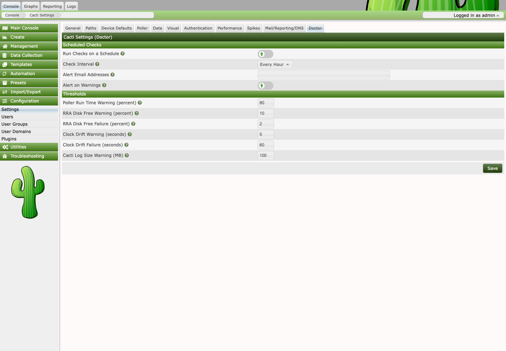

<!-- Source: README.md; SHA256: 851aec2768af6b0c9a21a3b0e62f902110b83588ad544fe6b87897cb61f82ace -->

<!-- translations:start -->
[English](../../../README.md) | [简体中文](../zh-CN/README.md) | [हिन्दी](../hi-IN/README.md) | [Español (España)](../es-ES/README.md) | [Español (Latinoamérica)](../es-419/README.md) | [العربية (السعودية)](../ar-SA/README.md) | [Afrikaans](../af-ZA/README.md) | [አማርኛ](../am-ET/README.md) | [العربية (مصر)](../ar-EG/README.md) | [العربية (المغرب)](../ar-MA/README.md) | [বাংলা](../bn-BD/README.md) | [Deutsch](../de-DE/README.md) | [فارسی](../fa-IR/README.md) | [Filipino](../fil-PH/README.md) | [Français](../fr-FR/README.md) | [Français (Maroc)](../fr-MA/README.md) | [Français (Sénégal)](../fr-SN/README.md) | [Hausa](../ha-NG/README.md) | [עברית](../he-IL/README.md) | [Bahasa Indonesia](../id-ID/README.md) | [Igbo](../ig-NG/README.md) | [Italiano](../it-IT/README.md) | [日本語](../ja-JP/README.md) | [한국어](../ko-KR/README.md) | [Malagasy](../mg-MG/README.md) | [मराठी](README.md) | [Bahasa Melayu](../ms-MY/README.md) | [Nederlands](../nl-NL/README.md) | [Polski](../pl-PL/README.md) | [Português (Brasil)](../pt-BR/README.md) | [Русский](../ru-RU/README.md) | [Kinyarwanda](../rw-RW/README.md) | [Soomaali](../so-SO/README.md) | [Svenska](../sv-SE/README.md) | [Kiswahili](../sw-KE/README.md) | [தமிழ்](../ta-IN/README.md) | [తెలుగు](../te-IN/README.md) | [ไทย](../th-TH/README.md) | [Türkçe](../tr-TR/README.md) | [Українська](../uk-UA/README.md) | [اردو](../ur-PK/README.md) | [Tiếng Việt](../vi-VN/README.md) | [isiXhosa](../xh-ZA/README.md) | [Yorùbá](../yo-NG/README.md) | [繁體中文](../zh-TW/README.md) | [isiZulu](../zu-ZA/README.md)
<!-- translations:end -->

<h1 align="center">
	<picture>
		<source media="(prefers-color-scheme: dark)" srcset="../../../images/doctor_logo_dark.png">
		
	</picture>
</h1>

<p align="center">
	<a href="https://github.com/somethingwithproof/plugin_doctor/actions/workflows/ci.yml"></a>
	<a href="https://sonarcloud.io/summary/new_code?id=somethingwithproof_plugin_doctor"></a>
	<a href="https://scorecard.dev/viewer/?uri=github.com/somethingwithproof/plugin_doctor"></a>
	<a href="../../../LICENSE"></a>
	
	
</p>

Cacti Doctor हे एक Cacti प्लगइन आहे जे एकाच तपासणीत इंस्टॉलेशनचे निदान करते आणि केवळ प्रशासकाने सांगितल्यावरच लहान दुरुस्त्या लागू करते.

**स्थिती: विकासाधीन, 1.0 पूर्वीची आवृत्ती.** नवीनतम प्रकाशन [0.6.1](https://github.com/somethingwithproof/plugin_doctor/releases/tag/v0.6.1) आहे. हा पॅच 0.6.0 मधील भूमिका-आधारित प्रवेश, मार्गदर्शित निदान, व्याप्ती-आधारित RRD ताजेपणा तपासण्या, दुरुस्ती पूर्वावलोकने व ऑडिट इतिहास, स्वीकारलेले चेतावणी अपवाद आणि भाषांतरांमध्ये हिंदी व अरबी कॅटलॉग तसेच भाषांतरित वापरकर्ता मार्गदर्शिका जोडतो. तपशीलांसाठी [CHANGELOG.md](../../../CHANGELOG.md) पहा.

## स्क्रीनशॉट्स

PHP 8.3.36 वर चालणाऱ्या एका विलग Cacti 1.2.31 प्रात्यक्षिक इंस्टॉलेशनमधील निदान आणि वेळापत्रक सेटिंग्ज, ज्यामध्ये Cacti PHP सुसंगतता, अपस्ट्रीम सुरक्षा-समर्थन आणि डेटाबेस-आरोग्य तपासण्या समाविष्ट आहेत. येथे दर्शविलेल्या चेतावण्या आणि अयशस्वी नोंदी त्या प्रात्यक्षिक वातावरणाचे वर्णन करतात.




Cacti मधील समस्या सहसा लक्षणांमधून दिसून येतात: रिकामे आलेख, थांबलेला पोलर किंवा इंस्टॉल न होणारे प्लगइन. यामागील कारण बहुतेकदा बदललेली पूर्वअट असते, जसे की CLI बिल्डमध्ये गहाळ PHP एक्स्टेंशन, पोलरला लिहिता न येणारी लॉग डिरेक्टरी, चुकीच्या बायनरीकडे निर्देश करणारा RRDtool मार्ग किंवा टाइमझोन सारण्या नसलेला डेटाबेस. Doctor या पूर्वअटी थेट तपासते आणि प्रत्येक तपासणीचा निकाल उत्तीर्ण, चेतावणी किंवा अयशस्वी म्हणून नोंदवून काय आढळले याचे एका वाक्यात स्पष्टीकरण देते. हाच अहवाल वेब पृष्ठावर, कमांड लाइनवर आणि देखरेखीसाठी JSON स्वरूपात उपलब्ध असतो.

## ते काय तपासते

| क्षेत्र | तपासण्या |
|---|---|
| Doctor | Doctor स्वतः root म्हणून चालत आहे का, ज्यामुळे परवानगी तपासण्या चुकीच्या खात्याचे वर्णन करतील |
| Cacti आणि PHP | Cacti आवृत्ती, इंस्टॉलरने कधीही पूर्ण न केलेले अपग्रेड, फाइल्स गहाळ असलेली सक्षम प्लगइन्स, इंस्टॉल केलेल्या Cacti पॅकेजशी PHP सुसंगतता, PHP अपस्ट्रीम सुरक्षा-समर्थन स्थिती |
| PHP एक्स्टेंशन्स | वेब PHP मध्ये आणि पोलर वापरत असलेल्या CLI PHP मधील आवश्यक एक्स्टेंशन्स, तसेच शिफारस केलेली वैशिष्ट्ये |
| PHP कॉन्फिगरेशन | Cacti च्या स्वतःच्या शिफारशी वापरून `memory_limit`, `max_execution_time`, आणि `date.timezone` |
| डेटाबेस | कनेक्टिव्हिटी, Cacti च्या शिफारशीशी सर्व्हर आवृत्तीची तुलना, UTF-8 वर्ण संच, टाइमझोन सारण्या, मुख्य सारण्या, PHP होस्टपासून घड्याळातील फरक आणि Cacti त्रुटी म्हणून चिन्हांकित करत असलेल्या InnoDB सेटिंग्ज |
| डेटाबेस आरोग्य | कनेक्शन क्षमता, बफर-पूल वाचन, डिस्क तात्पुरत्या सारण्या, कनेक्शन थ्रेड निर्मिती, मंद विधाने आणि InnoDB लॉग-बफर प्रतीक्षा, कार्यभारानुसार ट्यूनिंगच्या सूचनांसह |
| फाइलसिस्टम | लिहिण्यायोग्य कॅशे, लॉग आणि RRA डिरेक्टऱ्या; RRD फाइल्ससाठी मोकळी जागा; RRD फाइल नसलेले किंवा फाइल अद्यतने प्रलंबित असलेले सक्रिय डेटा स्रोत; `include/config.php` सर्वांना वाचण्यायोग्य नसणे; Cacti लॉग लिहिण्यायोग्य असणे आणि अतिमोठा नसणे |
| बायनरी | PHP CLI, RRDtool, `snmpget`, `snmpwalk`, आणि कॉन्फिगर केलेला पोलर Spine असल्यास तो, ज्यामध्ये Cacti ने नमूद केलेल्या आवृत्त्यांचाही समावेश आहे |
| लॉग | सर्वात अलीकडील Cacti लॉग ओळींमधील त्रुटी, सर्वाधिक वेळा आढळलेल्या संदेशासह |
| डिव्हाइसेस | बंद असलेली किंवा पुनर्प्राप्त होत असलेली सक्षम डिव्हाइसेस, सर्वाधिक काळ बंद असलेली तीन डिव्हाइसेस त्यांच्या शेवटच्या त्रुटीसह, आणि एकाच वेळी बहुतेक डिव्हाइसेस बंद असल्यास अयशस्वी नोंद |
| पोलर | पोलर प्रकार आणि अंतराल, मुख्य पोलर शेवटचा पूर्ण झाल्यापासूनचा कालावधी, अंतरालाच्या तुलनेत चालण्याचा वेळ, RRD फाइलपर्यंत न पोहोचलेले पोलर आउटपुट, अहवाल देणे थांबवलेले दूरस्थ पोलर्स, अडकलेला Boost, आणि वेगळ्या डेटाबेसकडे निर्देश करणारे Spine कॉन्फिगरेशन |

प्रत्येक तपासणीला `database.timezone` किंवा `binary.rrdtool` सारखा स्थिर ID असतो, ज्यामुळे स्क्रिप्ट्स वैयक्तिक निकालांवर आधारित प्रक्रिया करू शकतात.

## कोड आणि चाचणी नकाशा

| वर्तन | अंमलबजावणी | या रिपॉझिटरीमधील चाचणी पुरावा |
|---|---|---|
| निदान तपासण्या आणि स्थिर अहवाल IDs | [doctor_functions.php](../../../doctor_functions.php) | [DoctorFunctionsTest.php](../../../tests/DoctorFunctionsTest.php), [AssertDoctorReport.php](../../../tests/ci/AssertDoctorReport.php) |
| भूमिका-आधारित प्रवेश आणि संपादित वेब अहवाल | [doctor_access.php](../../../doctor_access.php), [doctor_web.php](../../../doctor_web.php) | [AccessTest.php](../../../tests/AccessTest.php), [WebAccessTest.php](../../../tests/WebAccessTest.php) |
| मार्गदर्शित लक्षण तपासण्या | [doctor_diagnosis.php](../../../doctor_diagnosis.php) | [DiagnosisTest.php](../../../tests/DiagnosisTest.php) |
| RRD ताजेपणा आणि विलंबित-लेखन हाताळणी | [doctor_rrd.php](../../../doctor_rrd.php) | [RrdFreshnessTest.php](../../../tests/RrdFreshnessTest.php) |
| दुरुस्ती पूर्वावलोकने, ऑडिट इतिहास आणि स्वीकारलेल्या चेतावण्या | [doctor_workflows.php](../../../doctor_workflows.php), [doctor_web.php](../../../doctor_web.php) | [WorkflowTest.php](../../../tests/WorkflowTest.php) |
| नियोजित तपासण्या आणि सूचना स्थित्यांतरण | [doctor_scheduling.php](../../../doctor_scheduling.php) | [DoctorFunctionsTest.php](../../../tests/DoctorFunctionsTest.php), [WorkflowTest.php](../../../tests/WorkflowTest.php) |

हे संदर्भ अंमलबजावणी आणि चाचणी व्याप्ती दर्शवतात; सध्याच्या आवृत्तीसाठी प्रत्येक CI कार्य उत्तीर्ण झाले आहे असे ते सांगत नाहीत. तुम्ही उपयोजित करू इच्छित असलेल्या आवृत्तीसाठी वर्कफ्लो रन तपासा.

## डेटाबेस आरोग्य सल्ला

Doctor चे मूळ PHP विश्लेषक Cacti च्या विद्यमान डेटाबेस कनेक्शनद्वारे जागतिक MySQL किंवा MariaDB काउंटर्सचा एक निश्चित संच वाचते. ते प्रति अहवाल दोन केवळ-वाचन क्वेरी करते, यासाठी कोणत्याही अतिरिक्त क्रेडेन्शियल्स किंवा एक्झिक्युटेबलची आवश्यकता नसते आणि ते डेटाबेस कॉन्फिगरेशन कधीही बदलत नाही. या तपासण्या वेब अहवाल, CLI, JSON, देखरेख आउटपुट, सपोर्ट बंडल आणि नियोजित स्थिती ट्रॅकिंगमध्ये दिसतात.

| तपासणी ID | तपासणी ट्रिगर |
|---|---|
| `database.health_sample` | स्टार्टअप किंवा `FLUSH STATUS` पासून 24 तासांपेक्षा कमी वेळ, किंवा अनुपलब्ध/विसंगत अपटाइम |
| `database.connection_capacity` | वर्तमान किंवा नोंदवलेली कमाल कनेक्शन्स वर्तमान `max_connections` च्या किमान 80% असणे |
| `database.buffer_pool_reads` | `Innodb_buffer_pool_reads / Innodb_buffer_pool_read_requests` किमान 1% असणे, किमान 10,000 वाचन विनंत्यांसह |
| `database.temporary_tables` | `Created_tmp_disk_tables / Created_tmp_tables` किमान 25% असणे, किमान 1,000 तात्पुरत्या सारण्यांसह |
| `database.thread_cache` | `Threads_created / Connections` किमान 5% असणे, किमान 1,000 कनेक्शन प्रयत्नांसह आणि `thread_handling=one-thread-per-connection` सह |
| `database.slow_queries` | `Slow_queries / Queries` किमान 1% असणे, किमान 1,000 विधानांसह |
| `database.redo_log_waits` | शून्येतर `Innodb_log_waits` |

या Doctor च्या तपासणी मर्यादा आहेत, विक्रेत्याची कॉन्फिगरेशन उद्दिष्टे नाहीत. कनेक्शन क्षमता वगळता, संचयी सल्ल्यासाठी वरील निरीक्षण कालावधी आवश्यक असतो. गहाळ, सदोष, दुहेरी किंवा अतिमोठे काउंटर्स, अपुरा वापर आणि असमर्थित थ्रेड मोड निरोगी निष्कर्ष किंवा ट्यूनिंग शिफारसीऐवजी चेतावण्या निर्माण करतात. **चेतावणांवर सूचना द्या** सक्षम असल्यास चेतावण्यांचा Nagios स्थिती आणि नियोजित सूचनांवर परिणाम होऊ शकतो.

मोजलेले काउंटर्स आणि सूचना एकत्रितपणे वाचा. संचयी मूल्ये वर्तमान भार सिद्ध करत नाहीत; काउंटर्सचा रीसेट इतिहास वेगवेगळा असू शकतो आणि तो एक अण्विक स्नॅपशॉट नसतो. कमाल कनेक्शन्स जुनी मर्यादा दर्शवू शकतात. मंद-क्वेरी संख्या `long_query_time` वर अवलंबून असते आणि MySQL चा डिस्क तात्पुरत्या-सारणीचा काउंटर मेमरी-मॅप्ड फाइल्स वगळू शकतो. कमी गुणोत्तर म्हणजे अडथळा नाहीच असे सिद्ध होत नाही. बफर किंवा कनेक्शन मर्यादा बदलण्यापूर्वी प्रातिनिधिक कार्यभाराखाली कलांची खात्री करा, क्वेरी योजना आणि कनेक्शन पुनर्वापराचे पुनरावलोकन करा तसेच **डेटाबेस होस्ट** वरील मेमरी मोजा.

जर मेट्रिक्स अनुपलब्ध असतील, तर सर्व्हर समर्थन आणि `SHOW GLOBAL STATUS` व `SHOW GLOBAL VARIABLES` साठी Cacti खात्याचा प्रवेश तपासा; Doctor उच्चाधिकारित क्रेडेन्शियल्सची मागणी करत नाही. काउंटर व्याख्या [MySQL स्थिती-व्हेरिएबल संदर्भातून](https://dev.mysql.com/doc/refman/8.0/en/server-status-variables.html) आणि [MariaDB स्थिती-व्हेरिएबल संदर्भातून](https://mariadb.com/docs/server/server-management/variables-and-modes/server-status-variables) येतात. कोणतीही MySQLTuner स्क्रिप्ट किंवा कोड वापरलेला नाही.

कोणत्याही स्कीमा किंवा कॉन्फिगरेशन स्थलांतराची आवश्यकता नाही. प्लगइन फाइल्स नेहमीप्रमाणे उपयोजित करा; त्या फाइल्स पूर्ववत केल्यास जोडलेली निदाने काढून टाकली जातात. विद्यमान नियोजित स्थिती पुढील रनवर ताजी केली जाते.

## हे सुरक्षित कसे राहते

निदान साधन हे पोलरच्या किंवा वेब सर्व्हरच्या विशेषाधिकारांसह चालते आणि सेटिंग्ज टेबलमधून पाथ वाचते, त्यामुळे ते काय कार्यान्वित करते आणि काय बदलते याबाबत सावधगिरी बाळगणे आवश्यक असते.

- निदान तपासण्या केवळ वाचण्यासाठी असतात. त्या कधीही फाइल्स, सेटिंग्ज किंवा डेटा बदलत नाहीत.
- कॉन्फिगर केलेल्या बायनरीचे फाइल नाव अपेक्षित प्रोग्रामशी (`php`, `rrdtool`, `snmpget`, किंवा `snmpwalk`) जुळत असेल तरच Doctor ती बायनरी चालवते. अन्यथा, सेटिंग्ज टेबलमध्ये लिहू शकणारी कोणतीही व्यक्ती Doctor ने काय चालवावे हे निवडू शकली असती. इतर कोणतेही नाव इशारा म्हणून नोंदवले जाते आणि ते कार्यान्वित केले जात नाही.
- Doctor कॉन्फिगर केलेल्या बायनरी कधीही root म्हणून चालवत नाही, आणि ते स्वतः root म्हणून चालत असल्यास त्याची नोंद देते.
- दुरुस्त्या एका निश्चित अनुमती यादीतून येतात. प्रत्येक दुरुस्तीसाठी वेब UI मध्ये प्रमाणित प्रशासकाची कृती किंवा CLI वर `--yes` आवश्यक असते, आणि प्रत्येक दुरुस्ती Cacti लॉगमध्ये नोंदवली जाते.

## प्रकाशने

आवृत्त्या SemVer चे पालन करतात आणि प्लगइनच्या `INFO` फाइलशी जुळतात. आवृत्ती निवड, CI गेट्स, पॅकेज सामग्री, चेकसम आणि रोलबॅक सूचनांसाठी [प्रकाशन प्रक्रिया](../../releasing.md) पहा.

## स्थापना

[GitHub प्रकाशने](https://github.com/somethingwithproof/plugin_doctor/releases) वरून `doctor-VERSION.tar.gz` किंवा `doctor-VERSION.zip` आणि `SHA256SUMS` डाउनलोड करा. संग्रहणाचा SHA-256 चेकसम तपासा, आणि नंतर त्यातील `doctor/` डिरेक्टरी Cacti च्या `plugins/` डिरेक्टरीमध्ये काढा. ही स्थापित करण्यायोग्य पॅकेजेस आहेत; GitHub च्या स्वयंचलित सोर्स संग्रहणांचे डिरेक्टरी नाव वेगळे असते. `develop` मधील अप्रकाशित कार्य चालवण्यासाठी, सोर्स चेकआउटमधून स्थापना करा.

सोर्स चेकआउटसाठी:

Cacti स्थापनेमध्ये रिपॉझिटरी `plugins/doctor` म्हणून क्लोन किंवा अनपॅक करा. डिरेक्टरीचे नाव `doctor` असणे आवश्यक आहे, `plugin_doctor` नाही.

```console
cd /path/to/cacti/plugins
git clone https://github.com/somethingwithproof/plugin_doctor.git doctor
```

**कॉन्फिगरेशन > प्लगइन व्यवस्थापन** मधून **Cacti Doctor** स्थापित आणि सक्षम करा, त्यानंतर Cacti वापरकर्ता किंवा गट परवानग्यांद्वारे **Doctor व्ह्यूअर**, **Doctor ऑपरेटर**, किंवा **Doctor प्रशासक** अधिकार क्षेत्र प्रदान करा. अपग्रेडनंतर विद्यमान **Cacti Doctor** अनुदानांकडे प्रशासक प्रवेश कायम राहतो. अहवाल **युटिलिटीज > Cacti Doctor** अंतर्गत दिसतो.

## भाषा

Doctor मध्ये स्पॅनिश (स्पेन, `es-ES`), फ्रेंच (`fr-FR`), जर्मन (`de-DE`), सरलीकृत चिनी (`zh-CN`), हिंदी (`hi-IN`), अरबी (`ar-SA`), आणि जपानी (`ja-JP`) भाषांतरे समाविष्ट आहेत. भाषा समर्थन चालू केल्यावर (**कॉन्फिगरेशन > सेटिंग्ज > सामान्य > भाषा समर्थन**) आणि वापरकर्त्याने भाषा निवडल्यावर Cacti ती दर्शवते. वेब पृष्ठ, सेटिंग्ज आणि कमांड लाइनद्वारे मुद्रित केलेले संदेश व अहवाल मजकूर Cacti च्या भाषेचे अनुसरण करतात; कमांड-लाइन अहवाल स्वतः Cacti ची डीफॉल्ट भाषा वापरतो, जी तुम्ही न बदलल्यास इंग्रजी राहते.

मशीन-वाचनीय आउटपुट कधीही भाषांतरित केले जात नाही: तपासणी आयडी, JSON की आणि स्थिती मूल्ये, `--format=nagios` आणि `--format=prometheus` आउटपुट, लॉग ओळी आणि सपोर्ट-बंडल विभाग शीर्षके इंग्रजीतच राहतात, जेणेकरून स्क्रिप्ट्स आणि देखरेख प्रत्येक भाषेत सुरळीत काम करत राहतील. प्रत्येक तपासणीचा `summary` आणि `detail` मजकूर हा JSON अहवालाचा एकमेव भाषांतरित भाग आहे.

लॅटिन अमेरिकन स्पॅनिश कॅटलॉग (`es-419`) देखील समाविष्ट आहे, परंतु Cacti 1.2 किंवा Cacti 1.3 मध्ये निवडण्यासाठी लॅटिन अमेरिकन स्पॅनिश लोकेल नाही, त्यामुळे Cacti ने ते जोडल्यावरच ते लागू होईल. तोपर्यंत, स्पॅनिश (`es-ES`) निवडा.

Cacti 1.2.x आणि 1.3 दोन्हीवर `doctor` हे टेक्स्ट डोमेन वापरून `plugins/doctor/locales/LC_MESSAGES/<locale>.mo` मधून प्लगइनचा कॅटलॉग लोड करते (1.3 आपल्या कॉन्फिगर करण्यायोग्य प्लगइन्स पाथद्वारे प्लगइन डिरेक्टरी शोधते).

## प्रवेश स्तर

| अधिकार क्षेत्र | क्षमता |
|---|---|
| Doctor व्ह्यूअर | नवीनतम नियोजित तपासणी स्थिती, निरीक्षण वेळ, ताजेपणा आणि अलीकडील एकत्रित इतिहास वाचणे. कोणतेही निदान कमांड्स, कच्चे तपशील, कॉन्फिगरेशन किंवा दुरुस्त्या नाहीत. |
| Doctor ऑपरेटर | 120-सेकंदांच्या प्रक्रिया मर्यादेसह निदान अहवाल चालवणे, संपादित केलेले तपशील तपासणे आणि निष्कर्षांची पोचपावती देणे. कोणतेही सेटिंग्ज बदल किंवा दुरुस्त्या नाहीत. |
| Doctor प्रशासक | ऑपरेटर क्षमता तसेच विद्यमान अनुमती-यादीतील दुरुस्ती आणि Doctor सेटिंग्ज. दुरुस्त्या आणि सेटिंग्जसाठी Cacti चे सेटिंग्ज/सिस्टम युटिलिटीज अधिकार क्षेत्र देखील आवश्यक असते. |

युटिलिटीज मेनू वापरकर्त्याला दिलेल्या सर्वोच्च Doctor अधिकार क्षेत्राचे पृष्ठ उघडतो, ज्यामध्ये गट अनुदानांचाही समावेश असतो. नवीन व्ह्यूअर आणि ऑपरेटर अधिकार क्षेत्रांना कोणतेही स्वयंचलित अनुदान मिळत नाही. मूळ अधिकार क्षेत्र आयडी प्रशासक म्हणून `doctor.php` शी जोडलेला राहतो, ज्यामुळे विद्यमान वापरकर्ता आणि गट प्रवेश जतन राहतो.

व्ह्यूअर डेटा नियोजित तपासण्यांमधून येतो. व्ह्यूअर प्रवेश देण्यापूर्वी वेळापत्रक सक्षम करा; गहाळ किंवा मुदत उलटलेली निरीक्षणे **अज्ञात** दर्शवतात, कधीही सुस्थितीत दर्शवत नाहीत. इतिहासामध्ये मागील 20 नियोजित एकत्रित संख्या जतन केल्या जातात आणि डिव्हाइस स्थिती वगळली जाते. ऑपरेटर स्पष्टपणे नवीन निदान सुरू करतात; सामान्य पृष्ठ रिफ्रेश त्यांच्या सत्राचा शेवटचा अहवाल वापरतात.

डिव्हाइस तपशील आणि एकूण संख्या सध्याच्या वापरकर्त्याच्या डिव्हाइस परवानग्या वापरतात. लॉग उताऱ्यांसाठी याव्यतिरिक्त Cacti चे लॉग प्रशासन अधिकार क्षेत्र आवश्यक असते. वेब सत्रात निदान तपशील संग्रहित करण्यापूर्वी किंवा प्रदर्शित करण्यापूर्वी गोपनीय माहिती लपवली जाते. CLI प्रवेश ऑपरेटिंग-सिस्टम खात्याद्वारे नियंत्रित राहतो.

पोचपावत्या वैयक्तिक असतात आणि Cacti लॉगमध्ये नोंदवल्या जातात. त्या केवळ त्याच निष्कर्षासाठी आणि पुराव्यासाठी लागू होतात; बदललेल्या पुराव्यासाठी नवीन पोचपावती आवश्यक असते. त्या कधीही उत्तीर्ण/इशारा/अपयशी स्थिती बदलत नाहीत, अलर्ट दाबत नाहीत किंवा अपयशी तपासणीला सुस्थितीत म्हणून चिन्हांकित करत नाहीत. हे स्वीकारलेल्या-इशारा अपवादांपेक्षा वेगळे आहे, जे निरीक्षण केलेल्या स्थितीत बदल न करता अलर्ट धोरणावर परिणाम करतात आणि त्यांचे वर्णन खाली केले आहे.

प्रत्येक कृतीसाठी POST आणि वैध CSRF टोकन आवश्यक असते. दुरुस्त्या सबमिट न करणाऱ्या 'रद्द करा' लिंकसह एक स्वतंत्र पुष्टीकरण पृष्ठ सादर करतात, आणि कृती करणारा वापरकर्ता व परिणाम Cacti लॉगमध्ये नोंदवतात.

## कमांड लाइन

हे root म्हणून नव्हे, तर Cacti पोलर वापरकर्ता म्हणून Cacti रूटमधून चालवा:

```console
php plugins/doctor/cli/doctor.php
php plugins/doctor/cli/doctor.php --json
php plugins/doctor/cli/doctor.php --repair=runtime_directories --yes
```

मजकूर आउटपुट प्रत्येक तपासणीसाठी तिची स्थिती, वर्ग, सारांश आणि तपशीलासह एक ओळ मुद्रित करते. `--json` स्थिती संख्यांसह एक `summary` ऑब्जेक्ट आणि `checks` अ‍ॅरे मुद्रित करते ज्याच्या नोंदींमध्ये `id`, `category`, `status`, `summary`, `detail`, आणि जेव्हा अनुमती-यादीतील दुरुस्ती लागू होते तेव्हा `repair`/`repairable` असते.

| एक्झिट स्थिती | अर्थ |
|---|---|
| `0` | कोणतीही तपासणी अपयशी ठरली नाही, किंवा विनंती केलेली दुरुस्ती यशस्वी झाली. इशाऱ्यांमुळे एक्झिट स्थिती बदलत नाही. |
| `1` | किमान एक तपासणी अपयशी ठरली, किंवा विनंती केलेली दुरुस्ती यशस्वी झाली नाही. |
| `2` | वापर त्रुटी: `--yes` शिवाय दुरुस्ती चालवली (`--preview` ला याची गरज नसते), अज्ञात दुरुस्ती आयडी, अज्ञात आउटपुट स्वरूप, असमर्थित `--symptom` किंवा स्वरूप संयोजन, किंवा न सापडलेली Cacti स्थापना. |

Cacti प्रत्येक CLI स्क्रिप्टसाठी `memory_limit` वाढवते, त्यामुळे PHP रनटाइम कॉन्फिगरेशन तपासणी केवळ वेब पृष्ठावरच अर्थपूर्ण असते.

## नियोजित तपासण्या आणि अलर्ट

**कॉन्फिगरेशन > सेटिंग्ज > Doctor** अंतर्गत, **नियोजित वेळापत्रकानुसार तपासण्या चालवा** चालू करा आणि 15 मिनिटांपासून एक दिवसापर्यंतचा कालावधी निवडा. देय असलेल्या प्रत्येक पोलर चक्रानंतर, Doctor पार्श्वभूमी प्रक्रियेत प्रत्येक तपासणी चालवते, त्यामुळे पोलरच्या स्वतःच्या चालण्याच्या वेळेवर परिणाम होत नाही.

प्रत्येक फेरी प्रत्येक तपासणीची निरीक्षण केलेली स्थिती नोंदवते. सक्रिय इशारा अपवाद त्या निरीक्षणात बदल न करता अलर्ट धोरणावर परिणाम करतात. जेव्हा एखादी तपासणी अपयशी होण्यास सुरुवात होते किंवा थांबते, तेव्हा Doctor हा बदल Cacti लॉगमध्ये लिहिते आणि जर **अलर्ट ईमेल पत्ते** सेट केलेले असतील, तर Cacti च्या मेल सेटिंग्जद्वारे त्या पत्त्यांवर ईमेल पाठवते. **इशाऱ्यांवर अलर्ट द्या** हे इशाऱ्यांमध्ये होणारे व त्यातून बाहेर पडणारे बदल जोडते. पहिली फेरी केवळ एक आधाररेषा नोंदवते.

नियोजित अहवाल प्राथमिक पोलरवर डेटाबेस सल्लागार लॉक अंतर्गत चालतात आणि त्यांना दोन मिनिटांची वर्कर मर्यादा असते. Doctor शेवटची सुरुवात आणि यशस्वी पूर्णता नोंदवते जेणेकरून गहाळ किंवा जुने परिणाम स्पष्ट दिसतील. कालावधी अधिक एक पोलिंग चक्र आणि तीन मिनिटांसाठी परिणाम अद्ययावत मानले जातात. पूर्ण न झालेली फेरी सामान्य कालावधीपर्यंत 5, 10, 20 आणि अधिक मिनिटांनंतर पुन्हा प्रयत्न केली जाते. अयशस्वी अलर्ट वितरण वाढत्या विलंबांसह जास्तीत जास्त तीन पुनर्प्रयत्नांसाठी जतन केले जाते; त्यानंतर, Cacti ची मेल सेटिंग्ज दुरुस्त करा आणि पोलर वापरकर्ता म्हणून `php plugins/doctor/cli/doctor.php --scheduled --retry-alerts` चालवा. मेल-सर्व्हरची स्वीकृती इनबॉक्स वितरणाची पुष्टी करत नाही.

हाच टॅब पोलर चालण्याचा वेळ (कालावधीच्या 80%), RRA मोकळी डिस्क जागा (10% पेक्षा कमी असल्यास इशारा, 2% पेक्षा कमी असल्यास अपयश), डेटाबेस घड्याळ विचलन (5 सेकंदांपेक्षा जास्त असल्यास इशारा, 60 पेक्षा जास्त असल्यास अपयश), आणि Cacti लॉग आकार (100 MB) यासाठी मर्यादा सेट करतो. रिक्त किंवा अवैध मूल्ये या डीफॉल्ट मूल्यांवर परत येतात.

## देखरेख एकत्रीकरण

```console
php plugins/doctor/cli/doctor.php --format=nagios
php plugins/doctor/cli/doctor.php --format=prometheus > /var/lib/node_exporter/textfile/cacti_doctor.prom
```

`--format=nagios` कार्यप्रदर्शन डेटासह एक स्थिती ओळ मुद्रित करते आणि `0` (OK), `1` (WARNING), किंवा `2` (CRITICAL) सह बाहेर पडते, त्यामुळे Nagios, Icinga, किंवा कोणतीही सुसंगत प्रणाली ते थेट चालवू शकते. `--format=prometheus` हे node_exporter च्या textfile कलेक्टरसाठी Prometheus मजकूर स्वरूप लिहिते: प्रत्येक तपासणीसाठी `cacti_doctor_check_status` (0 उत्तीर्ण किंवा स्वीकारलेला इशारा, 1 कार्यवाहीयोग्य इशारा, 2 अपयश), अपवादांपूर्वी `cacti_doctor_check_observed_status`, `cacti_doctor_check_accepted`, प्रत्येक स्थितीसाठी `cacti_doctor_checks`, आणि `cacti_doctor_last_run_timestamp_seconds`. JSON तपासणी ओळींमध्ये `assessment` फील्ड समाविष्ट असते; `not_assessed` म्हणजे उपलब्ध डेटावरून तपासणी कोणत्याही निष्कर्षापर्यंत पोहोचू शकली नाही.

## सपोर्ट बंडल

```console
php plugins/doctor/cli/doctor.php --bundle=/tmp/cacti-doctor.txt
```

बंडल ही एकच मजकूर फाइल आहे ज्यामध्ये Doctor, Cacti, PHP, OS आणि डेटाबेस आवृत्त्या, पोलर आणि Boost आकडेवारी, संपूर्ण अहवाल आणि Cacti लॉगच्या शेवटच्या 200 ओळी असतात. password, secret, token, community आणि key नावांनंतर येणारी मूल्ये लपवली जातात. Doctor ही फाइल केवळ तिच्या मालकाद्वारे वाचण्यायोग्य बनवते आणि विद्यमान फाइलवर पुन्हा लिहिण्यास नकार देते. ती कुठेही पोस्ट करण्यापूर्वी तिचे पुनरावलोकन करा.

## दुरुस्ती धोरण

डॉक्टरमध्ये `runtime_directories` ही एक दुरुस्ती समाविष्ट आहे. ती गहाळ असलेल्या कॅक्टाय रनटाइम डिरेक्टरी तयार करते आणि विद्यमान परवानग्या न काढता मालकाचे वाचन, लेखन आणि कार्यान्वयन बिट्स जोडते.

ती कॅक्टाय 1.3 वर `$cache_path`, `$log_path`, आणि `$rra_path` यांना लक्ष्य करते, किंवा अन्यथा इंस्टॉलेशनच्या `cache`, `log`, आणि `rra` डिरेक्टरींना लक्ष्य करते. ती आधीच लेखनीय असलेल्या डिरेक्टरी वगळते, कॅक्टाय इंस्टॉलेशनच्या बाहेरील डिरेक्टरी नाकारते (जसे की `/var/log` अंतर्गत असलेली लॉग डिरेक्टरी), सिम्बॉलिक लिंक्स नाकारते आणि रूट म्हणून चालण्यास नकार देते. ती कधीही `path_cactilog` चे अनुसरण करत नाही, त्यामुळे कोड डिरेक्टरीमध्ये कॉन्फिगर केलेली लॉग फाइल दुरुस्तीला तिकडे वळवू शकत नाही. निदान मात्र प्रत्येक प्रकाशनात कॉन्फिगर केलेल्या लॉग फाइलची डिरेक्टरी तपासत राहते.

ती मालकी बदलत नाही, शेल कमांड चालवत नाही, कॉन्फिगरेशन पुन्हा लिहीत नाही किंवा कॅक्टाय ॲप्लिकेशन डेटा बदलत नाही. प्रत्येक नवीन दुरुस्तीमध्ये एक निदान, अनुमती-सूचीबद्ध हँडलर, पुष्टीकरण, ऑडिट लॉगिंग आणि चाचण्या समाविष्ट असणे आवश्यक आहे.

## लक्षणांचा तपास करणे

ऑपरेटर आणि प्रशासक डॉक्टर पृष्ठावर **लक्षणाचा तपास करा** निवडू शकतात. हेच नियम मजकूर किंवा जेएसओएन आउटपुटसह `--symptom=graphs_stopped`, `slow_polling`, `devices_missing`, किंवा `alerts_missing` द्वारे उपलब्ध आहेत. सपोर्ट बंडल्समध्ये संबंधित लक्षण तपासणी समाविष्ट असते.

प्रत्येक संभाव्य कारणामध्ये निरीक्षित तपासण्या आणि पुढील पडताळणीची पायरी सूचीबद्ध असते. संभाव्य कारणे ही केवळ गृहीतके असतात, निश्चित मूळ कारणे नसतात. गहाळ, मूल्यांकन न झालेली किंवा जुनी निरीक्षणे कधीही कारण निश्चित करत नाहीत. वेब तपासण्या परवानगी-फिल्टर केलेला अहवाल वापरतात; सीएलआय अहवाल ऑपरेटिंग-सिस्टम खात्याचा प्रवेश वापरतात.

## आरआरडी अद्यतन ताजेपणा

`filesystem.rrd_stale` अक्षम आणि बंद उपकरणे वगळून कमाल 500 सक्रिय डेटा स्रोतांची तपासणी करते. मोठ्या इंस्टॉलेशन्सवर नमुना दर तासाला बदलतो, त्यामुळे वारंवार चालवल्यास वेगवेगळ्या फाइल्स तपासल्या जातात. ते फाइल बदलाच्या वेळेची तुलना पोलर अंतराल, स्रोत आरआरडी टप्पा आणि प्रोफाइल टप्पा यांपैकी मोठ्या मूल्याला **आरआरडी शिळे अंतराल** (डीफॉल्ट 3) ने गुणून येणाऱ्या मूल्याशी करते. ते तीन सर्वात जुन्या शिळ्या फाइल्स आणि प्रभावित उपकरणांची संख्या दर्शवते. वेब परिणामांमध्ये फक्त परवानगी असलेली उपकरणे समाविष्ट असतात.

`filesystem.rrd_files` ही एक स्वतंत्र अस्तित्व तपासणी आहे. ती अक्षम किंवा बंद उपकरणांवरील डेटा स्रोतांसह कमाल 5,000 सक्रिय डेटा स्रोतांच्या आरआरडी फाइलचा शोध घेते आणि तोच तासाभराचा नमुना वापरते.

बूस्ट डिस्क-लेखन सवलत म्हणून त्याच्या कॉन्फिगर केलेल्या फ्लश अंतरालाच्या दुप्पट वेळ जोडते. दुसऱ्या विलंबित लेखकासाठी, **विलंबित आरआरडी लेखन भत्ता (सेकंद)** कॉन्फिगर करा. भत्त्याशिवाय जाहीर केलेला `RRDCACHED_ADDRESS`, किंवा अवैध बूस्ट अंतराल, मूल्यांकन न झालेला परिणाम देतो. ही तपासणी करण्यासाठी डॉक्टर कधीही कॅशे फ्लश करत नाही. बदलाची वेळ हा डिस्कवरील क्रियेचा पुरावा आहे, यशस्वी डेटा संकलनाचा पुरावा नाही. डॉक्टर शोधू शकत नाही असे बाह्य कॅशिंग स्पष्टपणे कॉन्फिगर करणे आवश्यक आहे.

गहाळ, वाचता न येणाऱ्या आणि भविष्यकालीन तारखेच्या फाइल्सची गणना तपशिलात केली जाते. जेव्हा कोणतीही नमुना फाइल वाचण्यायोग्य नसते तेव्हाच परिणाम मूल्यांकन न झालेला असतो. नमुना परिणाम असे नमूद करतो की तो इंस्टॉलेशनच्या केवळ एका भागाचा समावेश करतो; उत्तीर्ण परिणामामध्ये नमुना न घेतलेल्या फाइल्सचा समावेश होत नाही.

## दुरुस्ती पूर्वावलोकने आणि ऑडिट इतिहास

प्रशासक दुरुस्ती पृष्ठ प्रत्येक प्रभावित मार्ग, त्याची प्रस्तावित क्रिया, सध्याच्या परवानग्या आणि लक्ष्य परवानग्या दर्शवते. मंजुरी त्या पूर्वावलोकनाशी, कार्य करणाऱ्या वापरकर्त्याशी आणि पाच मिनिटांच्या कालावधीशी जोडलेली असते. पुष्टीकरण पूर्वावलोकन वापरते; बदललेल्या फाइलसिस्टमसाठी आणखी एक पूर्वावलोकन आवश्यक असते. रूट कार्यान्वयन, इंस्टॉलेशनच्या बाहेरील मार्ग, दुरुस्ती आवश्यक असलेले दुवे आणि अपूर्ण फाइलसिस्टम परवानग्या मंजुरीला प्रतिबंध करतात.

`--repair=runtime_directories --preview` केवळ-वाचनीय जेएसओएन योजना मुद्रित करते. `--repair=runtime_directories --yes` नव्याने गणना केलेल्या सीएलआय योजनेला मंजुरी देते आणि कार्यान्वित करण्यापूर्वी तिची पुन्हा तपासणी करते. सीएलआय खाते इंस्टॉलेशन दुरुस्त करण्यासाठी आधीच अधिकृत असणे आवश्यक आहे; ते वेब भूमिका वारशाने घेत नाही.

कोणत्याही फाइलसिस्टम बदलापूर्वी संरचित `repair.started` नोंद जतन करणे आवश्यक आहे. जोडलेल्या `repair.completed` नोंदीमध्ये दुरुस्तीनंतरचा स्नॅपशॉट आणि पडताळणी परिणाम असतो. व्यत्यय आलेली क्रिया तपासासाठी प्रारंभ केलेली नोंद मागे ठेवते. फाइलसिस्टम बदल झाले असले तरीही पूर्णता-ऑडिट अपयश हे अपयश म्हणून नोंदवले जाते. डॉक्टर मालकाच्या परवानग्या जोडते आणि डिरेक्टरी तयार करते; ते स्वयंचलित रोलबॅकचा प्रयत्न करत नाही.

कॅक्टायच्या सेटिंग्ज/सिस्टम उपयुक्तता परवानगी असलेले प्रशासक डॉक्टर पृष्ठावर नवीनतम 20 ऑडिट नोंदी वाचू शकतात. प्लगइन `plugin_doctor_audit` मध्ये नवीनतम 200 नोंदी राखून ठेवते; कॅक्टाय लॉग देखील त्यांचे आयडी, क्रिया आणि कर्ते नोंदवते. ऑडिट पेलोड्समधील गोपनीय तपशील वगळलेले असतात.

## स्वीकारलेल्या चेतावण्या

कॅक्टायच्या सेटिंग्ज/सिस्टम उपयुक्तता परवानगी असलेले प्रशासक डॉक्टर पृष्ठावरील ताज्या, मूल्यांकन केलेल्या चेतावणीतून **चेतावणी अपवाद** तयार करू शकतात. अपवादासाठी मालक, कारण आणि 90 दिवसांच्या आतील यूटीसी पुनरावलोकन तारीख आवश्यक असते. तो त्या तारखेच्या सुरुवातीस यूटीसी मध्यरात्री कालबाह्य होतो. कमाल 100 अपवाद कॉन्फिगर केले जाऊ शकतात. सूचीमध्ये कालबाह्य झालेल्या नोंदी आणि सध्याच्या अहवालात नसलेले आयडी प्रदर्शित केले जातात आणि काढून टाकण्याची परवानगी दिली जाते.

निरीक्षित चेतावणी निदान तपशिलांमध्ये तिचा मालक, कारण आणि कालबाह्यता यांच्यासह दृश्यमान राहते. जेएसओएन निरीक्षित स्थिती कायम ठेवते आणि `accepted` तसेच `acceptance` मेटाडेटा जोडते. नागिओस सक्रिय स्वीकारलेल्या चेतावण्या त्याच्या निर्गमन तीव्रतेतून वगळते परंतु त्याच्या आउटपुटमध्ये त्यांची नावे नमूद करते. प्रोमिथियस निरीक्षित आणि कृती करण्यायोग्य अशा दोन्ही तीव्रता निर्यात करते. सामान्य सीएलआय निर्गमन स्थिती अपरिवर्तित राहते: चेतावण्या आधीच शून्य स्थितीसह बाहेर पडतात, अपयश एक स्थितीसह बाहेर पडतात.

अपवाद लागू असताना नियोजित चेतावणी सूचना दाबल्या जातात; कालबाह्यता किंवा काढून टाकण्यामुळे सुरू असलेली चेतावणी पुन्हा चेतावणी सूचनांसाठी पात्र ठरते. अपयशातील स्थित्यंतरे आणि अपयशातून पुनर्प्राप्ती सूचनांसाठी पात्र राहतात. मूल्यांकन न झालेला परिणाम किंवा अपयश स्वीकारले जाऊ शकत नाही. वैयक्तिक पोचपावती स्वतंत्र आहे आणि ती काहीही दाबत नाही. अपवाद निर्मिती आणि काढून टाकणे ऑडिट नोंदीसह व्यवहारनिष्ठ असते.

अपग्रेड कॅक्टाय ॲप्लिकेशन डेटा न बदलता `plugin_doctor_audit` आणि `plugin_doctor_acceptance` तयार करते. अनइंस्टॉल करण्यापूर्वी तुम्हाला आवश्यक असलेला कोणताही इतिहास निर्यात करा: अनइंस्टॉल दोन्ही प्लगइन टेबल्स आणि त्याची सेटिंग्ज काढून टाकते. प्लगइन फाइल्स मागील आवृत्तीवर परत नेल्यास तपासासाठी टेबल्स उपलब्ध राहतात, परंतु जुन्या आवृत्त्या चेतावणी अपवादांचा आदर करत नाहीत.

## आवश्यकता

| कॅक्टाय | पीएचपी | टिपा |
|---|---|---|
| 1.2.20 | 5.4 किंवा नवीन | डॉक्टरचा स्वतःचा कोड पीएचपी 5.4 सुसंगत आहे जेणेकरून तो अपग्रेडपूर्वी जुन्या प्रणालींचे निदान करू शकेल |
| 1.2.31 | 8.0 किंवा नवीन | कॅक्टायच्या `composer.json` ला `>=8.0` आवश्यक आहे |
| सध्याचे 1.2.x | 8.2 किंवा नवीन | कॅक्टायच्या `composer.json` ला `>=8.2` आवश्यक आहे |
| `develop` (1.3) | 8.3 किंवा नवीन | कॅक्टायच्या `composer.json` ला `^8.3` आवश्यक आहे |

**स्थापित कॅक्टायसह पीएचपी सुसंगतता** ही ओळ कार्यरत पीएचपी आवृत्तीची तुलना कॅक्टायच्या स्वतःच्या रूट `composer.json` मधील पीएचपी आवश्यकतेशी करते, ज्यामध्ये `^8.3` सारख्या कॅरेट मर्यादेच्या वरच्या मर्यादेचाही समावेश आहे. कॉन्फिगर केलेल्या पीएचपी सीएलआय कार्यान्वयनीय फाइलची त्याच आवश्यकतेनुसार तपासणी केली जाते. या कॅक्टाय पॅकेजेसद्वारे वापरलेले `>=` आणि `^` मर्यादा स्वरूप डॉक्टर ओळखते. वाचता न येणारी, विकृत, गहाळ किंवा न ओळखलेली आवश्यकता चेतावणी निर्माण करते; मॅनिफेस्टशिवाय असलेल्या कॅक्टाय 1.2.20–1.2.30 इंस्टॉलेशन्समध्ये त्यांची दस्तऐवजीकरण केलेली पीएचपी 5.4 इंस्टॉलर किमान पातळी कायम राहते. डॉक्टरची स्वतःची पीएचपी 5.4 सुसंगतता नवीन कॅक्टाय इंस्टॉलेशनशी सुसंगतता सिद्ध करत नाही.

**पीएचपी अपस्ट्रीम सुरक्षा समर्थन** ही ओळ एका वेगळ्या प्रश्नाचे उत्तर देते: त्या पीएचपी प्रकाशन शाखेला अजूनही पीएचपी प्रकल्पाकडून सुरक्षा निराकरणे मिळतात का? ती शाखेची प्रकाशित सुरक्षा-समर्थन समाप्ती तारीख नोंदवते आणि त्या तारखेनंतर चेतावणी देते. उदाहरणार्थ, पीएचपी 8.1 जुन्या कॅक्टाय इंस्टॉलेशनची रनटाइम आवश्यकता पूर्ण करू शकते, जरी त्याला यापुढे अपस्ट्रीम सुरक्षा निराकरणे मिळत नसली तरीही. उत्तीर्ण परिणामाचा अर्थ असा नाही की स्थापित पॅच प्रकाशन अद्ययावत आहे, आणि ओएस विक्रेता बॅकपोर्ट केलेली निराकरणे पुरवतो की नाही हे डॉक्टर ठरवू शकत नाही.

समर्थन तारखा [पीएचपी समर्थन वेळापत्रक](https://www.php.net/supported-versions.php) आणि [समाप्ती कालावधी सूची](https://www.php.net/eol.php) मधून डॉक्टरसोबत एकत्रित केलेल्या आहेत, ज्यांची शेवटची तपासणी 2026-11-08 रोजी केली गेली. अज्ञात शाखा आणि पूर्व-प्रकाशने गृहीत उत्तीर्ण परिणामाऐवजी चेतावणी देतात. निदानादरम्यान कोणतीही नेटवर्क विनंती केली जात नाही. पीएचपी नवीन वेळापत्रक प्रकाशित करते तेव्हा डॉक्टरचा समर्थन डेटा अद्यतनित करा. विद्यमान जेएसओएन/निरीक्षण आयडी `php.version` आणि `php.security_baseline` अपरिवर्तित आहेत.

## विकास

युनिट संच पेस्ट वापरतो आणि पीएचपी 8.2 किंवा नवीनवर चालतो:

```console
composer install
composer test
```

या चाचण्या डॉक्टरने कॉल केलेल्या कॅक्टाय फंक्शन्सच्या जागी `tests/CactiStubs.php` मधील लहान पर्यायी रूपे वापरतात, त्यामुळे त्या कॅक्टाय इंस्टॉलेशनशिवाय चालतात.

गिटहब ॲक्शन्स प्रत्येक पुश आणि पुल विनंतीवर चार प्रकारच्या तपासण्या चालवते:

- पीएचपी 5.4, 5.6, 7.0, 7.1, 7.4 आणि 8.0 ते 8.4 अंतर्गत प्रत्येक पीएचपी फाइलवर `php -l`.
- पीएचपी 8.2, 8.3 आणि 8.4 वर युनिट संच.
- `locales/build_gettext.sh --check`, जे जुन्या भाषांतर टेम्पलेटवर, अपूर्ण किंवा अस्पष्ट कॅटलॉगवर, किंवा त्याच्या स्रोतापेक्षा वेगळ्या असलेल्या संकलित कॅटलॉगवर अयशस्वी होते.
- सात एकत्रीकरण कामे जी मायएसक्यूएल आणि मारियाडीबी विरुद्ध कॅक्टाय 1.2.20, सध्याची 1.2.x शाखा आणि `develop` हे दोन्ही cmd.php आणि स्पाइनसह स्थापित करतात. प्रत्येक काम प्लगइन स्थापित आणि सक्षम करते, संपूर्ण सीएलआय अहवाल चालवते आणि अहवाल स्कीमा, सारांश बेरीज, अपेक्षित स्थिती आणि अपयशांचा अचूक संच तपासते. त्यानंतर ते बायनरी मार्ग आणि पोलर टाइमस्टॅम्प खंडित करते, दोन्हींची नोंद झाल्याची खात्री करते, त्यांना पुनर्संचयित करते, दुरुस्ती आणि तिचे पुष्टीकरण वापरून पाहते, आणि अक्षम, सक्षम, अनइंस्टॉल आणि पुन्हा इंस्टॉल चालवते. काम अयशस्वी झाल्यास जेएसओएन अहवाल आर्टिफॅक्ट म्हणून ठेवला जातो.

## योगदान

पुल विनंत्या `develop` कडे पाठवा. प्रोडक्शन फाइल्स PHP 5.4 सुसंगत ठेवा आणि Cacti ची शैली वापरा: टॅब्स, सिंगल-कोटेड स्ट्रिंग्ज, आणि `read_config_option()` व `db_fetch_cell()` यांसारखे Cacti हेल्पर्स. प्रत्येक वर्तणूक बदलासाठी एक युनिट टेस्ट जोडा, तुमच्या कमिट्सवर साइन ऑफ करा (`git commit -s`), आणि `CHANGELOG.md` मध्ये एक ओळ जोडा.

### भाषांतरे

वापरकर्त्याला दिसणारा प्रत्येक संदेश `__('...', 'doctor')` (किंवा `__n()`, `__x()`, `__esc()`) मध्ये गुंडाळा, आणि एखाद्या वाक्यात मूल्य असल्यास भाग जोडण्याऐवजी क्रमाने येणाऱ्या `%s`/`%d` प्लेसहोल्डर्ससह एकच फॉरमॅट स्ट्रिंग द्या. Cacti चे `__()` संदेशात फॉरमॅट स्पेसिफायर असेल तेव्हाच त्याला फॉरमॅट करते आणि ते पोझिशनल `%1$s` रूपांना समर्थन देत नाही. ते फॉरमॅटिंगपूर्वी `%%` चे रूपांतर `%` मध्ये देखील करते, त्यामुळे संदेशात कधीही थेट टक्केवारीचे चिन्ह ठेवू नका: मूल्य त्याच्या चिन्हासह आर्ग्युमेंट म्हणून पास करा (`__('Usage: %s', '50%', 'doctor')`). लॉग ओळी इंग्रजीतच राहतात: दुरुस्तीच्या मजकुरासाठी `doctor_repair_message()` वापरा आणि जे संदेश लॉग केले जातात आणि फक्त दाखवले जातात तिथेच भाषांतरित केले जातात त्यांच्यासाठी `doctor_n_()` वापरा. चेक आयडी, JSON की, स्थिती दर्शवणारे कीवर्ड्स, मॉनिटरिंग आउटपुट आणि लॉग ओळी भाषांतरित न करता तशाच ठेवा.

`locales/build_gettext.sh` हे `locales/po/cacti.pot` टेम्पलेट पुन्हा तयार करते, ते प्रत्येक कॅटलॉग `locales/po/<locale>.po` मध्ये विलीन करते आणि `locales/LC_MESSAGES/<locale>.mo` संकलित करते; हे तिन्ही कमिट करा. CI हे `sh locales/build_gettext.sh --check` चालवते, जे टेम्पलेट जुने असल्यास, कॅटलॉगमध्ये एखादी नोंद गहाळ असल्यास किंवा फझी नोंद असल्यास, प्लेसहोल्डर वेगळा असल्यास, किंवा संकलित केलेली फाइल कालबाह्य असल्यास अयशस्वी होते. त्यामुळे बदललेल्या संदेशाची भाषांतरे त्याच पुल विनंतीमध्ये अद्यतनित करणे आवश्यक आहे. यासाठी GNU gettext (`xgettext`, `msgmerge`, `msgfmt`, `msgunfmt`) आवश्यक आहे. नवीन भाषा म्हणजे Cacti ज्या प्रकारे आपल्या लोकेल्सना नावे देते त्यानुसार नाव दिलेली नवीन `<locale>.po` फाइल (उदाहरणार्थ `pt-BR`).

## सुरक्षा

सुरक्षा त्रुटींची तक्रार सार्वजनिक इश्यूजमध्ये न करता [SECURITY.md](../../../SECURITY.md) मध्ये वर्णन केल्याप्रमाणे खाजगीरीत्या करा.

## परवाना

कॉपीराइट (C) 2026 Thomas Vincent. GNU General Public License, आवृत्ती 2 किंवा त्यानंतरच्या आवृत्तीअंतर्गत प्रकाशित. [LICENSE](../../../LICENSE) पहा.
